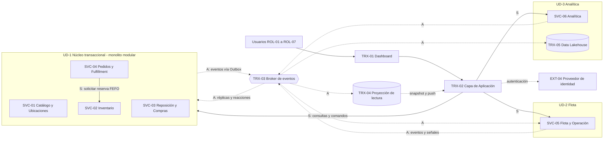
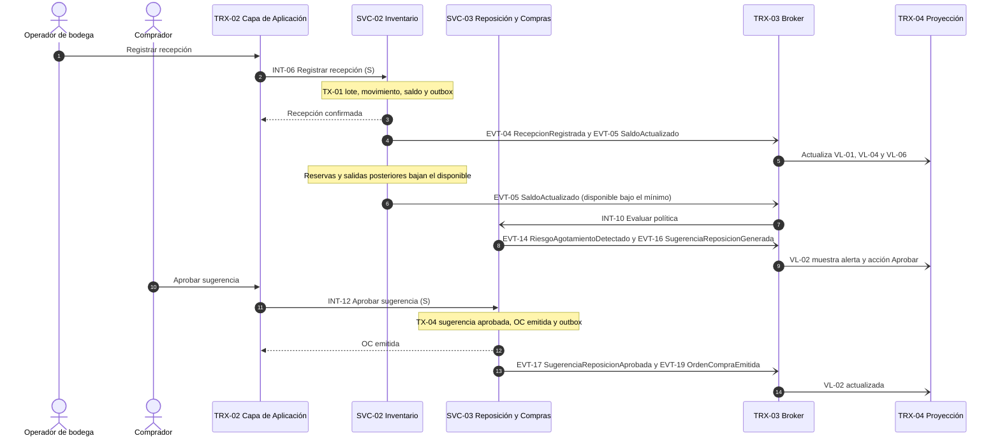

# Smart Inventory · Arquitectura base (Contrato Maestro)

| Campo | Valor |
|---|---|
| Documento | `docs/ARQUITECTURA_BASE.md` |
| Versión | **1.0.0** |
| Estado | Propuesto para aprobación del equipo (Sprint 1 · HU-06) |
| Dueño | P1 · Líder de arquitectura |
| Revisión | P7 + aprobación de los 7 integrantes (registrada en acta) |
| Fecha | 2026-11-20 |
| Documento hermano | [`docs/BACKLOG.md`](BACKLOG.md) |
| Materia | Diseño de Sistemas · USFQ · Deber "Smart Inventory: arquitectura integral y gestión del proyecto" |

> **Regla de oro.** Este documento es la **fuente única** de nombres, límites, datos, eventos, interacciones y vistas. Todo diagrama, ADR, flujo, informe o presentación del equipo usa **exactamente** estos identificadores. Si algo falta, se propone un cambio (§0.3); nunca se inventa un nombre ni un sinónimo.

---

## 0. Cómo usar este documento

### 0.1 Para qué sirve

Permite que los siete integrantes (P1–P7) trabajen en paralelo, cada uno con su propia IA, sin producir diagramas, flujos o ADR contradictorios. Define **qué existe** (capacidades, datos, eventos, interacciones, vistas) y **quién es dueño** de cada cosa. El detalle (diagramas C4/UML, ADR completos, requisitos refinados) lo producen las historias de trabajo de `docs/BACKLOG.md`.

### 0.2 Identificadores canónicos

| Prefijo | Identifica | Ejemplo | Definido en |
|---|---|---|---|
| `SVC-nn` | Capacidad / módulo de negocio | SVC-02 Inventario | §3 |
| `TRX-nn` | Componente transversal | TRX-04 Proyección de lectura | §4.1 |
| `EXT-nn` | Sistema externo | EXT-01 ERP corporativo | §4.2 |
| `UD-n` | Unidad de despliegue | UD-1 Núcleo transaccional | §2.3 |
| `PRI-nn` | Principio de diseño | PRI-02 Sin escritura cruzada | §2.2 |
| `EVT-nn` | Evento de negocio oficial | EVT-05 SaldoActualizado | §6 |
| `INT-nn` | Interacción entre componentes | INT-19 Solicitar reserva FEFO | §7.2 |
| `TX-nn` / `CE-nn` | Transacción local / consistencia eventual | TX-02 Reserva | §7.3 |
| `VL-nn` | Vista de lectura del dashboard | VL-04 Planta interna | §8 |
| `SUP-nn` | Supuesto de carga | SUP-02 Carga normal | §11.1 |
| `RNF-XXX-nn` | Requisito de calidad (semilla) | RNF-REN-03 | §11.2 |
| `FAL-nn` | Escenario de fallo | FAL-01 Broker caído | §11.3 |
| `ROL-nn` / `OPS-nn` | Rol de seguridad / operación sensible | ROL-03 Comprador | §11.4 |
| `ADR-nnn` | Decisión de arquitectura | ADR-003 | §12 |
| `EP` / `HN` / `HU` / `P` | Épica / historia de negocio / historia de trabajo / integrante | HU-14, P4 | `BACKLOG.md` |

**Forma de citar:** la primera vez en cada artefacto se escribe ID + nombre (`EVT-05 SaldoActualizado`); después basta el ID.

### 0.3 Cómo se cambia este contrato

1. Quien detecta la necesidad abre un PR que modifica este archivo. Si cambia un límite, el dueño de un dato, o agrega/renombra/elimina un SVC, EVT o INT, crea además un ADR en estado *Propuesto*.
2. Revisan **P1** y el **diseñador responsable del módulo afectado** (§3.0).
3. Al aprobarse: se sube la versión según `BACKLOG.md` §7.2, se actualiza el historial (al final de este archivo) y `CHANGELOG.md`, y se avisa al equipo.
4. Mientras no se apruebe, el elemento nuevo se marca **«PROPUESTA»** en cualquier borrador y no se usa como oficial.

---

## 1. Respuestas a las decisiones exigidas por el enunciado

| Decisión que el equipo debe documentar (§3 del enunciado) | Respuesta del contrato | Dónde |
|---|---|---|
| Qué servicios se despliegan por separado y cuáles se agrupan en el MVP | UD-1 agrupa SVC-01 a SVC-04 como monolito modular; SVC-05 (UD-2) y SVC-06 (UD-3) van separados desde el MVP | §2.3, ADR-001, ADR-007 |
| Fuente autorizada de SKU, saldo, lote, pedido, reserva, compra y telemetría | SKU → SVC-01 · saldo, lote, vencimiento y reserva → SVC-02 · compra → SVC-03 · pedido → SVC-04 · telemetría → SVC-05 | §5, ADR-002, ADR-003 |
| Qué interacciones son inmediatas y cuáles asíncronas | Comandos del usuario, consultas de detalle y la reserva son síncronos; los hechos de negocio se propagan por eventos | §7, ADR-004 |
| Qué datos necesita el dashboard, su tiempo máximo de actualización y cómo informa la consistencia eventual | Vistas VL-01 a VL-07; ≤ 5 s (≤ 2 s para AMR); indicador de frescura con 3 estados | §8, ADR-005 |
| Requisitos de seguridad y disponibilidad; dependencias y fallos | Roles ROL-01 a ROL-07, operaciones sensibles OPS-01 a OPS-08, RNF semilla y escenarios FAL-01 a FAL-09 | §11 |

---

## 2. Enfoque arquitectónico

### 2.1 Estilo: monolito modular evolutivo (ADR-001)

Smart Inventory arranca como un **monolito modular** para el núcleo transaccional, con **dos unidades separadas desde el MVP** (Flota y Analítica), y evoluciona hacia microservicios **extrayendo módulos cuando aparezcan señales concretas** (§2.4).

**Por qué:**

- **Consistencia donde importa.** Recepción, reserva y salida necesitan transacciones locales (TX-01 a TX-03). Dentro del núcleo eso es simple y confiable.
- **Costo operativo proporcional al MVP.** Desplegar seis servicios desde el inicio multiplica fallos parciales, latencia de red y monitoreo sin beneficio para la carga inicial (SUP-01 a SUP-03).
- **Límites ya trazados.** Cada módulo tiene esquema propio, puertos y eventos (PRI-09): extraerlo después cambia su despliegue, no sus interacciones.
- **Separar desde ya lo que es distinto.** Flota (telemetría continua, hardware, fallos propios) y Analítica (cargas pesadas, otro ritmo de cambio) no deben competir con el núcleo transaccional.

**Costo aceptado:** riesgo de que los límites se erosionen dentro del monolito. **Mitigación:** PRI-02, credenciales por esquema, checklist de revisión cruzada (`BACKLOG.md` §6.3) y RNF-MAN-02.

### 2.2 Principios de límites y datos

| ID | Principio | Consecuencia práctica |
|---|---|---|
| PRI-01 | **Un dueño por dato.** Cada entidad tiene exactamente un módulo dueño (§5). | Si un dato aparece con dos dueños, el diseño está mal. |
| PRI-02 | **Sin escritura cruzada.** Ningún módulo lee ni escribe directamente el esquema de otro. | Se usa una operación del dueño (síncrona) o un evento (asíncrono). |
| PRI-03 | **Referencias por identificador.** Entre módulos se comparte el ID (SKU, pedido, OC), no el objeto. | No hay claves foráneas ni joins entre esquemas. |
| PRI-04 | **Réplicas locales de solo lectura** para datos de referencia, alimentadas por eventos (ADR-009). | Inventario no llama a Catálogo en cada recepción; usa su réplica. |
| PRI-05 | **Hechos por eventos, decisiones en el dueño.** Un evento informa algo ya ocurrido; la decisión la toma quien es dueño del dato. | La proyección nunca decide reponer; lo decide SVC-03. |
| PRI-06 | **Outbox e idempotencia** en todo evento de negocio. | Cambio de negocio y evento se guardan en la misma transacción; los consumidores toleran duplicados. |
| PRI-07 | **El dashboard no es fuente de verdad.** Las acciones se validan en la capacidad dueña, nunca contra la proyección. | "Aprobar sugerencia" va a SVC-03, que verifica el estado vigente. |
| PRI-08 | **Puertos y adaptadores.** El dominio depende de interfaces; las integraciones externas se encapsulan en adaptadores. | Cambiar de ERP o transportista no toca el dominio. |
| PRI-09 | **Mismo contrato en monolito y en microservicios.** Los módulos de UD-1 se comunican como si ya estuvieran separados (puertos + eventos). | Extraer SVC-02 no obliga a rediseñar flujos. |

### 2.3 Unidades de despliegue del MVP

| UD | Contiene | Por qué así en el MVP | Escala según |
|---|---|---|---|
| **UD-1 Núcleo transaccional** (monolito modular) | SVC-01, SVC-02, SVC-03, SVC-04 | Comparten ritmo de cambio y necesitan transacciones locales simples; un solo despliegue reduce complejidad | Usuarios concurrentes, pedidos/hora |
| **UD-2 Flota y Operación** | SVC-05 | Telemetría continua, integración con hardware (EXT-03) y fallos propios; su caída no debe afectar inventario (ADR-007) | Número de AMR y vehículos activos |
| **UD-3 Analítica** | SVC-06 + TRX-05 | Procesos pesados (históricos, predicciones) con otro ritmo; no deben consumir recursos transaccionales | Volumen de eventos y cálculos |
| **UD-4 Acceso** | TRX-01, TRX-02 | Punto de entrada de usuarios; se replica sin tocar el núcleo | Usuarios conectados |
| **UD-5 Proyección de lectura** | TRX-04 | Consumidor reconstruible que puede escalar por separado | Retraso de consumo de eventos |
| *Infraestructura* | TRX-03 (broker), EXT-04 (IdP) | Servicios gestionados; no son código del equipo | — |

**Aislamiento de datos.** Las bases de datos son **propiedad lógica** de cada módulo. En el MVP pueden compartir el mismo motor físico, pero cada módulo tiene **su propio esquema y su propia credencial con permisos solo sobre ese esquema** (Figura 1 del enunciado).

Boceto de referencia (el C4 oficial se produce en HU-11, HU-12 y siguientes):

*S = síncrono (respuesta inmediata) · A = asíncrono (evento).*

### 2.4 Ruta de evolución hacia microservicios

| Orden | Módulo | Señal que justifica extraerlo | Qué cambia al extraerlo |
|---|---|---|---|
| 1 | SVC-02 Inventario | La reserva incumple RNF-REN-02 en pico de forma sostenida, o se requiere disponibilidad independiente del resto del núcleo | Pasa a UD propia; INT-19 deja de ser llamada interna y se vuelve remota (mismo puerto `GestionReservas`) |
| 2 | SVC-04 Pedidos y Fulfillment | Picos de pedidos (≥ 3× la carga normal) que degradan al resto del núcleo, o nuevos canales de venta | UD propia; escala con pedidos/hora |
| 3 | SVC-03 Reposición y Compras | Más proveedores e integraciones ERP, o cambios frecuentes de políticas | UD propia; adaptadores ERP aislados |
| — | SVC-01 Catálogo y Ubicaciones | Se mantiene agrupado (bajo volumen, cambios poco frecuentes). Solo se separaría si se vuelve maestro corporativo multibodega | — |

---

## 3. Catálogo de capacidades (SVC)

### 3.0 Resumen

| ID | Capacidad | Responsabilidad principal | Datos propietarios (fuente de verdad) | UD MVP | Diseña |
|---|---|---|---|---|---|
| SVC-01 | Catálogo y Ubicaciones | Maestro de productos y de la estructura física de la bodega | Producto (SKU), categoría, bodega, zona, ubicación | UD-1 | P4 |
| SVC-02 | Inventario | Existencias por SKU · ubicación · lote; movimientos; reservas con FEFO | Saldo, lote, **fecha de vencimiento**, movimiento, recepción, ajuste, **reserva** | UD-1 | P4 |
| SVC-03 | Reposición y Compras | Detectar riesgo de agotamiento, sugerir, aprobar y emitir compras | Política de reposición (mínimos), alerta de riesgo, sugerencia, proveedor, orden de compra | UD-1 | P5 |
| SVC-04 | Pedidos y Fulfillment | Ciclo de vida del pedido: reserva, preparación y despacho | Pedido y su estado, tarea de preparación, solicitud de despacho | UD-1 | P6 |
| SVC-05 | Flota y Operación | AMR, rutas, telemetría, vehículos, muelles y patio | AMR, misión, ruta, telemetría, visita de vehículo, muelle, patio | UD-2 | P6 |
| SVC-06 | Analítica | Histórico, indicadores y predicciones | Lakehouse (TRX-05), indicadores históricos, pronóstico de demanda | UD-3 | P7 |

### 3.1 SVC-01 · Catálogo y Ubicaciones

| Aspecto | Definición |
|---|---|
| Responsabilidad | Mantener el maestro de productos y la estructura física (bodegas, zonas, ubicaciones). |
| No es responsable de | Cuánto hay en cada ubicación (SVC-02) ni de muelles y patio (SVC-05). |
| Datos propietarios | **Producto**: SKU único, nombre, categoría, unidad de medida, controla lote (sí/no), requiere vencimiento (sí/no), vida útil mínima de despacho, estado (activo/descontinuado). **Categoría. Bodega. Zona** (recepción, almacenamiento, picking, despacho). **Ubicación**: código, zona, tipo, capacidad, estado (activa/bloqueada). |
| Réplicas locales | Ninguna. |
| Operaciones que ofrece | Registrar o actualizar producto; definir bodega, zona y ubicación; bloquear ubicación; consultar catálogo. |
| Publica | EVT-01, EVT-02, EVT-03 |
| Consume | — |
| Reglas clave | El SKU es único e inmutable. Un producto descontinuado no admite nuevas recepciones. Una ubicación bloqueada no admite existencias nuevas. |
| Despliegue | UD-1. Permanece agrupado (§2.4). |

### 3.2 SVC-02 · Inventario

| Aspecto | Definición |
|---|---|
| Responsabilidad | Ser la **fuente de verdad de existencias** por SKU · ubicación · lote. Registrar movimientos inmutables (recepción, transferencia, ajuste, salida), administrar lotes y vencimientos, y gestionar **reservas de stock aplicando FEFO** (ADR-003). |
| No es responsable de | Definir productos o ubicaciones (SVC-01), decidir cuándo reponer (SVC-03), el estado del pedido (SVC-04). |
| Datos propietarios | **Saldo**: físico, reservado, disponible. **Lote**: número, SKU, fecha de vencimiento, estado. **Movimiento** (inmutable): tipo, cantidad, origen/destino, documento de referencia, usuario, momento. **Recepción** (puede referenciar una OC). **Ajuste** (motivo, autorizador). **Reserva**: pedido de referencia, asignación por lote y ubicación, estado. |
| Réplicas locales | Productos y ubicaciones (EVT-01 a EVT-03); OC emitidas pendientes de recepción (EVT-19, EVT-20). |
| Operaciones que ofrece | Registrar recepción · registrar transferencia · registrar ajuste · consultar existencias · solicitar reserva. *(Liberar reserva y registrar salida se activan por EVT-28 y EVT-27.)* |
| Publica | EVT-04 a EVT-13 |
| Consume | EVT-01, EVT-02, EVT-03, EVT-19, EVT-20, EVT-27, EVT-28 |
| Reglas clave | **Disponible = físico − reservado**; los lotes *Vencido* o *EnCuarentena* no cuentan como disponibles. **El disponible nunca es negativo** (RNF-CON-01). Movimiento + saldo + outbox en una sola transacción (TX-01, TX-03). Un movimiento nunca se edita; se corrige con un ajuste. **FEFO:** se asignan primero los lotes con vencimiento más próximo que cumplan la vida útil mínima de despacho; a igual fecha, el de recepción más antigua; productos sin vencimiento usan FIFO. Proceso periódico propio detecta lotes en umbral de vencimiento (EVT-12) y vencidos (EVT-13). |
| Despliegue | UD-1. **Primer candidato a extracción** (§2.4). |

### 3.3 SVC-03 · Reposición y Compras

| Aspecto | Definición |
|---|---|
| Responsabilidad | Evaluar cada cambio de saldo contra la política del SKU, **detectar el riesgo de agotamiento** (ADR-006), calcular sugerencias, gestionar su aprobación y emitir órdenes de compra. |
| No es responsable de | Registrar movimientos o saldos (SVC-02); recibir físicamente la mercadería (SVC-02). |
| Datos propietarios | **Política de reposición** por SKU: mínimo, punto de reorden, cantidad objetivo, estrategia. **Alerta de riesgo de agotamiento** (activa/resuelta). **Sugerencia de reposición**: cantidad, proveedor, justificación, estado. **Proveedor**: datos, lead time, condiciones. **Orden de compra (OC)**: líneas, proveedor, estado. |
| Réplicas locales | Catálogo (EVT-01, EVT-02); disponible agregado por SKU (EVT-05); demanda no atendida (EVT-09); pronóstico de demanda (EVT-37). |
| Operaciones que ofrece | Configurar política · consultar sugerencias · aprobar o rechazar sugerencia · gestionar proveedores · consultar OC. |
| Publica | EVT-14 a EVT-20 |
| Consume | EVT-01, EVT-02, EVT-04, EVT-05, EVT-09, EVT-37 |
| Reglas clave | Una sola sugerencia vigente por SKU (una nueva *reemplaza* a la anterior). La aprobación es humana en el MVP y se valida contra el estado vigente. Aprobar crea la OC en la misma transacción (TX-04). La OC se envía al ERP mediante adaptador (INT-14). Sin pronóstico disponible se usa `ReposicionMinMax`. |
| Despliegue | UD-1. Extraíble si crecen las integraciones (§2.4). |

### 3.4 SVC-04 · Pedidos y Fulfillment

| Aspecto | Definición |
|---|---|
| Responsabilidad | Gestionar el ciclo de vida del pedido: registrar, **solicitar la reserva a Inventario**, crear la tarea de preparación, solicitar el despacho y cerrar el pedido. |
| No es responsable de | Decidir qué lote se asigna (SVC-02, FEFO) ni asignar AMR, vehículo o muelle (SVC-05). |
| Datos propietarios | **Pedido**: líneas, destino, fecha compromiso, prioridad, estado (§9). **Tarea de preparación.** **Solicitud de despacho.** Guarda el identificador de la reserva y una **copia de solo lectura** de la asignación por lote recibida en la respuesta, para armar la lista de preparación (el dueño sigue siendo SVC-02). |
| Réplicas locales | Catálogo (EVT-01, EVT-02); muelle asignado (EVT-34). |
| Operaciones que ofrece | Registrar pedido · cancelar pedido · consultar pedido · confirmar preparación. |
| Publica | EVT-21 a EVT-28 |
| Consume | EVT-01, EVT-02, EVT-29, EVT-30, EVT-34, EVT-35 |
| Reglas clave | Transiciones controladas por `EstadoPedido` (patrón State). Reserva **todo o nada** en el MVP. Si Inventario no responde, el pedido queda *PendienteReserva* y se reintenta con el identificador del pedido como clave de idempotencia. Solo se cancela antes de *EnDespacho*. |
| Despliegue | UD-1. Segundo candidato a extracción (§2.4). |

### 3.5 SVC-05 · Flota y Operación

| Aspecto | Definición |
|---|---|
| Responsabilidad | Operar la flota interna (AMR, misiones, rutas, telemetría) y la operación externa (vehículos, muelles, patio, acceso). |
| No es responsable de | Estados del pedido (SVC-04) ni existencias (SVC-02). |
| Datos propietarios | **AMR**: estado, batería, capacidad. **Misión AMR**: tarea, ruta, estado. **Ruta.** **Telemetría**: posiciones y batería (serie temporal de retención corta). **Visita de vehículo**: camión, transportista, tipo (entrada/salida), estado. **Muelle**: estado, asignación. **Patio**: acceso, zona de espera. |
| Réplicas locales | Ubicaciones y layout (EVT-03) para calcular rutas; OC emitidas (EVT-19) para anticipar llegadas de proveedores. |
| Operaciones que ofrece | Registrar llegada o salida manual · asignar muelle · reasignar o abortar misión · consultar flota y patio. |
| Publica | EVT-29 a EVT-36 |
| Consume | EVT-03, EVT-19, EVT-24, EVT-26, EVT-28 |
| Reglas clave | Un AMR sin señal por más de 10 s o *FueraDeServicio* no recibe misiones. **La telemetría cruda no sale de SVC-05**; solo se publica la señal muestreada EVT-32. Asignación de AMR por estrategia (`EstrategiaAsignacionAmr`). Integraciones con EXT-02, EXT-03 y EXT-05 solo mediante adaptadores. |
| Despliegue | **UD-2, separado desde el MVP** (ADR-007). |

### 3.6 SVC-06 · Analítica

| Aspecto | Definición |
|---|---|
| Responsabilidad | Conservar el histórico de hechos de negocio y calcular indicadores (rotación, quiebres, vencimientos, puntualidad) y predicciones (demanda). |
| No es responsable de | Ningún dato operativo; **nunca es fuente de verdad** de saldo, pedido o compra. |
| Datos propietarios | **Data Lakehouse** (TRX-05): zona cruda (eventos tal como llegan) y zona curada. **Indicadores históricos. Pronóstico de demanda.** |
| Réplicas locales | No aplica: todo su contenido es derivado de eventos. |
| Operaciones que ofrece | Consultar indicadores históricos · consultar pronóstico. |
| Publica | EVT-37, EVT-38 |
| Consume | Todos los eventos de tipo *Negocio* (§6.2). EVT-32 solo por muestreo. |
| Reglas clave | Datos derivados y recalculables. Sus resultados llegan a la operación solo como eventos (EVT-37), nunca por consulta directa al Lakehouse desde otro módulo. |
| Despliegue | UD-3. |

---

## 4. Componentes transversales y sistemas externos

### 4.1 Componentes transversales (TRX)

| ID | Componente | Responsabilidad | Lo que **no** hace | Diseña |
|---|---|---|---|---|
| **TRX-01** | **Dashboard** (Centro de operaciones LogistPulse) | Interfaz de supervisión con dos modos que comparten KPIs, alertas, flujo de pedidos y actividad reciente: **Planta interna** (racks, lotes, zonas, AMR) y **Planta externa** (camiones, muelles, acceso, zona de espera). Muestra la frescura de cada vista. | No guarda datos de negocio. No decide. Sus botones solo envían comandos a la capacidad dueña a través de TRX-02. | P2 |
| **TRX-02** | **Capa de Aplicación** | Coordina consultas y acciones del dashboard: autentica con EXT-04, compone vistas (proyección + consulta al dueño cuando se necesita el dato exacto) y enruta cada comando a su dueño. | No contiene reglas de negocio ni base de datos de negocio. La autorización final la hace el módulo dueño. | P1 |
| **TRX-03** | **Broker de eventos** | Publicación/suscripción con entrega *al menos una vez*, reintentos acotados y cola de mensajes fallidos (DLQ). Orden garantizado por entidad. Dos canales conceptuales: **eventos de negocio** (durables) y **señales de telemetría** (muestreadas, pérdida tolerable). | No transforma datos ni aplica reglas de negocio. Su configuración técnica corresponde a Desarrollo de Software Moderno. | P1 |
| **TRX-04** | **Proyección de lectura** (CQRS) | Mantiene las vistas VL-01 a VL-07 a partir de eventos; registra el momento del último evento aplicado en cada vista; entrega snapshot inicial y actualizaciones en vivo (push, p. ej. SSE como en la Figura 1). Reconstruible reprocesando eventos. | **No es fuente de verdad**, no recibe comandos, no genera alertas ni decisiones (PRI-05, PRI-07). | P7 |
| **TRX-05** | **Data Lakehouse** | Almacén histórico de SVC-06 (custodia lógica de SVC-06). | No se usa para decisiones transaccionales. | P7 |

### 4.2 Sistemas externos (EXT)

| ID | Sistema | Relación con Smart Inventory | Interacciones |
|---|---|---|---|
| EXT-01 | ERP corporativo | Recibe órdenes de compra; envía pedidos de venta | INT-14, INT-18 |
| EXT-02 | Sistemas de transportistas | Confirman vehículos y horarios de retiro | INT-27 |
| EXT-03 | Controlador de flota AMR (fabricante) | Ejecuta misiones; emite telemetría | INT-22, INT-23 |
| EXT-04 | Proveedor de identidad (IdP) | Autentica usuarios y entrega sus roles | INT-02 |
| EXT-05 | Control de acceso del patio (garita / sensores) | Informa llegadas y salidas de vehículos | INT-28 |

---

## 5. Propiedad de datos (fuente única de verdad)

| Dato | Dueño (único) | Quién más lo usa | Cómo lo obtiene |
|---|---|---|---|
| Producto / **SKU**, categoría | SVC-01 | SVC-02, SVC-03, SVC-04, SVC-06, TRX-04 | Réplica local por EVT-01, EVT-02 |
| Bodega, zona, **ubicación** | SVC-01 | SVC-02, SVC-05, SVC-06, TRX-04 | Réplica local por EVT-03 |
| **Saldo** (físico, reservado, disponible) | SVC-02 | SVC-03 (agregado por SKU), TRX-04, SVC-06 | EVT-05; detalle exacto por consulta síncrona INT-15 |
| **Lote** y **fecha de vencimiento** | SVC-02 | SVC-04 (copia de asignación), TRX-04, SVC-06 | EVT-04, EVT-08, EVT-12, EVT-13; respuesta de INT-19 |
| **Movimiento** (recepción, transferencia, ajuste, salida) | SVC-02 | TRX-04, SVC-06 | EVT-04, EVT-06, EVT-07, EVT-11 |
| **Reserva** de stock | SVC-02 | SVC-04 (solo identificador y copia de asignación), TRX-04 | Respuesta de INT-19; EVT-08, EVT-09, EVT-10 |
| Política de reposición (**mínimos**) | SVC-03 | TRX-04 (de forma indirecta) | EVT-14, EVT-15 |
| Alerta de riesgo de agotamiento | SVC-03 | TRX-04, SVC-06 | EVT-14, EVT-15 |
| Sugerencia de reposición | SVC-03 | TRX-04, SVC-06 | EVT-16 a EVT-18; detalle por consulta síncrona |
| Proveedor | SVC-03 | — | Consulta en SVC-03 |
| **Orden de compra** | SVC-03 | SVC-02 (recepciones esperadas), SVC-05 (llegadas esperadas), TRX-04, SVC-06 | EVT-19, EVT-20 |
| **Pedido** y su estado | SVC-04 | TRX-04, SVC-06 | EVT-21 a EVT-28 |
| Tarea de preparación | SVC-04 | SVC-05 | EVT-24 |
| AMR, misión, ruta | SVC-05 | SVC-04 (estado de la misión), TRX-04, SVC-06 | EVT-29 a EVT-31 |
| **Telemetría** (posición, batería) | SVC-05 | TRX-04 (muestreada) | EVT-32 (señal) |
| Visita de vehículo, muelle, patio | SVC-05 | SVC-04 (muelle asignado), TRX-04, SVC-06 | EVT-33 a EVT-36 |
| Pronóstico de demanda | SVC-06 | SVC-03 | Copia local por EVT-37 |
| Indicadores históricos | SVC-06 | TRX-04 | EVT-38; consulta INT-34 |
| Vistas del dashboard | TRX-04 (**derivado, no es fuente de verdad**) | TRX-02 | INT-03 |
| Usuarios y roles | EXT-04 | TRX-02 y cada módulo dueño | INT-02 |
| Auditoría de operaciones sensibles | El módulo dueño de cada operación | SVC-06 | Registro propio + evento correspondiente |

---

## 6. Eventos de negocio oficiales

### 6.1 Convenciones y reglas

- **Nombre:** sustantivo + participio en pasado, PascalCase, en español **sin tildes ni ñ** (`SaldoActualizado`, `OrdenCompraEmitida`). No se traducen al inglés.
- **Solo el dueño emite** los eventos de sus entidades (§5).
- **Inmutables:** un evento no se corrige; se emite otro evento.
- **Tipo *Negocio*:** durable, sale por Outbox (PRI-06) y llega al Lakehouse. **Tipo *Señal*:** muestreada, no durable, pérdida tolerable, solo para visualización (únicamente EVT-32).
- **Entrega al menos una vez →** todo consumidor es idempotente (registra qué eventos ya procesó).
- **Orden por entidad:** los eventos de una misma entidad (p. ej., un mismo SKU · ubicación · lote) llegan en orden.
- **Errores persistentes:** tras reintentos acotados, el evento pasa a la DLQ y genera una alerta operativa (FAL-08).
- A nivel de diseño, cada evento identifica la entidad afectada, el momento del hecho, el módulo emisor y un identificador único. **El contenido técnico del mensaje (campos, formato, versión de esquema) corresponde a Desarrollo de Software Moderno.**

### 6.2 Catálogo

| ID | Evento | Tipo | Productor | Consumidores | Hecho que comunica | Flujo |
|---|---|---|---|---|---|---|
| EVT-01 | ProductoRegistrado | Negocio | SVC-01 | SVC-02, SVC-03, SVC-04, TRX-04, SVC-06 | Se creó un producto con su SKU | T |
| EVT-02 | ProductoActualizado | Negocio | SVC-01 | SVC-02, SVC-03, SVC-04, TRX-04, SVC-06 | Cambiaron atributos del producto (incluye descontinuación y reglas de lote/vencimiento) | T |
| EVT-03 | UbicacionActualizada | Negocio | SVC-01 | SVC-02, SVC-05, TRX-04, SVC-06 | Se creó, modificó o bloqueó una ubicación | T |
| EVT-04 | RecepcionRegistrada | Negocio | SVC-02 | SVC-03, TRX-04, SVC-06 | Ingresó mercadería (SKU, lote, ubicación; OC si aplica) | A |
| EVT-05 | SaldoActualizado | Negocio | SVC-02 | SVC-03, TRX-04, SVC-06 | Cambió el saldo físico o disponible de un SKU · ubicación · lote | A, B, C |
| EVT-06 | TransferenciaRegistrada | Negocio | SVC-02 | TRX-04, SVC-06 | Se movió stock entre ubicaciones | T |
| EVT-07 | AjusteRegistrado | Negocio | SVC-02 | TRX-04, SVC-06 | Se corrigió el saldo con motivo y autorización | T |
| EVT-08 | ReservaConfirmada | Negocio | SVC-02 | TRX-04, SVC-06 | Se reservó stock por lote con FEFO para un pedido | C |
| EVT-09 | ReservaRechazada | Negocio | SVC-02 | SVC-03, TRX-04, SVC-06 | No hubo disponible suficiente para un pedido | C, B |
| EVT-10 | ReservaLiberada | Negocio | SVC-02 | TRX-04, SVC-06 | Se liberó una reserva (cancelación o expiración) | C |
| EVT-11 | SalidaRegistrada | Negocio | SVC-02 | TRX-04, SVC-06 | Salió stock consumiendo una reserva | C |
| EVT-12 | LoteProximoAVencer | Negocio | SVC-02 | TRX-04, SVC-06 | Un lote entró en el umbral de días de alerta | A |
| EVT-13 | LoteVencido | Negocio | SVC-02 | TRX-04, SVC-06 | Un lote venció y quedó excluido de reservas | A |
| EVT-14 | RiesgoAgotamientoDetectado | Negocio | SVC-03 | TRX-04, SVC-06 | Un SKU quedó bajo su mínimo | B |
| EVT-15 | RiesgoAgotamientoResuelto | Negocio | SVC-03 | TRX-04, SVC-06 | El SKU volvió a estar sobre su mínimo | B |
| EVT-16 | SugerenciaReposicionGenerada | Negocio | SVC-03 | TRX-04, SVC-06 | Hay una sugerencia vigente para un SKU | B |
| EVT-17 | SugerenciaReposicionAprobada | Negocio | SVC-03 | TRX-04, SVC-06 | Un comprador aprobó la sugerencia | B |
| EVT-18 | SugerenciaReposicionRechazada | Negocio | SVC-03 | TRX-04, SVC-06 | Un comprador rechazó la sugerencia | B |
| EVT-19 | OrdenCompraEmitida | Negocio | SVC-03 | SVC-02, SVC-05, TRX-04, SVC-06 | Se creó una OC a partir de una sugerencia aprobada | B |
| EVT-20 | OrdenCompraCerrada | Negocio | SVC-03 | SVC-02, TRX-04, SVC-06 | La OC se recibió completa | A, B |
| EVT-21 | PedidoRegistrado | Negocio | SVC-04 | TRX-04, SVC-06 | Ingresó un pedido | C |
| EVT-22 | PedidoReservado | Negocio | SVC-04 | TRX-04, SVC-06 | El pedido tiene todo su stock reservado | C |
| EVT-23 | PedidoEnEspera | Negocio | SVC-04 | TRX-04, SVC-06 | El pedido espera por falta de stock | C |
| EVT-24 | PreparacionSolicitada | Negocio | SVC-04 | SVC-05, TRX-04 | Se creó la tarea de preparación (picking) | C |
| EVT-25 | PreparacionCompletada | Negocio | SVC-04 | TRX-04, SVC-06 | La preparación terminó y fue confirmada | C |
| EVT-26 | DespachoSolicitado | Negocio | SVC-04 | SVC-05, TRX-04, SVC-06 | El pedido necesita muelle y vehículo | C |
| EVT-27 | PedidoDespachado | Negocio | SVC-04 | SVC-02, TRX-04, SVC-06 | El pedido salió de la bodega | C |
| EVT-28 | PedidoCancelado | Negocio | SVC-04 | SVC-02, SVC-05, TRX-04, SVC-06 | El pedido se canceló antes del despacho | C |
| EVT-29 | MisionAmrAsignada | Negocio | SVC-05 | SVC-04, TRX-04 | Un AMR recibió una misión con su ruta | C |
| EVT-30 | MisionAmrCompletada | Negocio | SVC-05 | SVC-04, TRX-04, SVC-06 | El AMR terminó su misión | C |
| EVT-31 | EstadoAmrCambiado | Negocio | SVC-05 | TRX-04, SVC-06 | Un AMR cambió de estado (disponible, cargando, detenido, fuera de servicio) | C |
| EVT-32 | PosicionFlotaActualizada | **Señal** | SVC-05 | TRX-04 | Posición muestreada de AMR para la planta interna | C |
| EVT-33 | VehiculoArribado | Negocio | SVC-05 | TRX-04, SVC-06 | Un camión llegó al acceso o a la zona de espera | A, C |
| EVT-34 | MuelleAsignado | Negocio | SVC-05 | SVC-04, TRX-04 | Se asignó muelle a una visita de vehículo | C |
| EVT-35 | VehiculoDespachado | Negocio | SVC-05 | SVC-04, TRX-04, SVC-06 | El camión cargado salió del patio | C |
| EVT-36 | MuelleLiberado | Negocio | SVC-05 | TRX-04, SVC-06 | El muelle quedó disponible | C |
| EVT-37 | PronosticoDemandaActualizado | Negocio | SVC-06 | SVC-03 | Hay un nuevo pronóstico de demanda por SKU | B |
| EVT-38 | IndicadoresHistoricosActualizados | Negocio | SVC-06 | TRX-04 | Se recalcularon rotación, quiebres, vencimientos y puntualidad | T |

*Flujo: A = Recepción · B = Reposición · C = Reserva, FEFO y despacho · T = Transversal.*

### 6.3 Cadena del flujo vertical (presentación final)

Recorrido exigido: **recepción → actualización de stock → alerta → reposición**, cerrado con la recepción de la OC.

| Paso | Qué ocurre | Dueño | Interacción | Eventos | Qué ve el dashboard |
|---|---|---|---|---|---|
| 1 | El operador registra la recepción del SKU X (lote, vencimiento, ubicación) | ROL-01 → SVC-02 | INT-01, INT-06 (S) | — | — |
| 2 | Inventario guarda lote + movimiento + saldo + outbox (TX-01) | SVC-02 | INT-07 | EVT-04, EVT-05 | VL-01 unidades, VL-04, VL-06 |
| 3 | Pedidos consumen stock: reservas y salidas bajan el disponible de X | SVC-04 → SVC-02 | INT-19, INT-30 | EVT-08, EVT-11, EVT-05 | VL-01, VL-03 |
| 4 | Reposición evalúa EVT-05 contra la política de X: disponible < mínimo | SVC-03 | INT-10 | EVT-14 | VL-02 alerta; VL-01 "Productos bajo mínimo" |
| 5 | Reposición calcula la sugerencia (mínimo, demanda, lead time) | SVC-03 | INT-11 | EVT-16 | VL-02 botón "Aprobar" |
| 6 | El comprador aprueba; SVC-03 valida el estado vigente y crea la OC (TX-04) | ROL-03 → SVC-03 | INT-12 (S) | EVT-17, EVT-19 | VL-02 actualizada |
| 7 | La OC se envía al ERP | SVC-03 → EXT-01 | INT-14 (A) | — | — |
| 8 | Llega el camión del proveedor y se recibe la OC | SVC-05, SVC-02 | INT-28, INT-06 | EVT-33, EVT-04, EVT-05 | VL-05, VL-01 |
| 9 | Reposición cierra la OC y resuelve el riesgo | SVC-03 | INT-09, INT-10 | EVT-20, EVT-15 | La alerta desaparece de VL-02 |

---

## 7. Reglas de interacción: síncrono vs. asíncrono

### 7.1 Criterios

**Síncrono (S)**, con respuesta inmediata, cuando:

- **S1.** Un usuario espera el resultado para continuar (registrar recepción, aprobar sugerencia).
- **S2.** La operación protege un invariante que debe confirmarse antes de seguir (reserva: el disponible nunca es negativo).
- **S3.** Se necesita el dato exacto de la fuente de verdad en ese momento (detalle de existencias por lote).

**Asíncrono (A)**, por evento, cuando:

- **A1.** Se comunica un hecho ya ocurrido a uno o varios interesados.
- **A2.** El receptor puede reaccionar segundos después sin dañar el negocio (proyección, Lakehouse, réplicas, alertas).
- **A3.** El receptor es externo o inestable y conviene desacoplarlo con reintentos (ERP, transportistas).
- **A4.** El retraso se resuelve **del lado conservador**: liberar una reserva tarde nunca provoca sobreventa.

**Reglas de protección:**

- Toda llamada S entre módulos tiene **tiempo límite** y **Circuit Breaker** en el adaptador del consumidor (p. ej., SVC-04 hacia SVC-02).
- **Solo se reintentan operaciones idempotentes** (la reserva usa el identificador del pedido como clave de idempotencia).
- **Máximo dos saltos síncronos** por operación: Capa de Aplicación → módulo dueño → como mucho un módulo más.

### 7.2 Interacciones base (semilla de la matriz de interacciones, HU-24)

| ID | Origen → Destino | Propósito | Modo | Flujo | Si el destino falla |
|---|---|---|---|---|---|
| INT-01 | TRX-01 → TRX-02 | Toda consulta y comando del usuario | S | Todos | Sin UI; UD-4 se replica |
| INT-02 | TRX-02 → EXT-04 | Autenticar usuario y obtener roles | S | Todos | FAL-07 |
| INT-03 | TRX-02 → TRX-04 | Leer snapshot inicial y suscribirse a actualizaciones en vivo | S + A (push) | Todos | Vista marcada "Desactualizada" (FAL-06) |
| INT-04 | SVC-01 → TRX-03 → SVC-02, SVC-03, SVC-04, SVC-05 | Mantener réplicas de catálogo y ubicaciones (EVT-01 a EVT-03) | A | T | Réplica atrasada; un SKU nuevo tarda en ser recibible (CE-02) |
| INT-05 | Todos los SVC → TRX-03 → SVC-06 / TRX-05 | Ingesta histórica de eventos | A | T | Retraso analítico sin impacto operativo |
| INT-06 | TRX-02 → SVC-02 | Registrar recepción (valida contra réplicas de catálogo y de OC) | S | A | No se registra; la UI conserva los datos y avisa (FAL-02) |
| INT-07 | SVC-02 → TRX-03 | Publicar EVT-04 y EVT-05 vía Outbox | A | A | Eventos esperan en outbox (FAL-01) |
| INT-08 | TRX-03 → TRX-04 | Actualizar VL-01, VL-04 y VL-06 | A | A | Vista con retraso visible |
| INT-09 | TRX-03 → SVC-03 | EVT-04 con OC → avance o cierre de OC (EVT-20) | A | A, B | Cierre de OC diferido (CE-06) |
| INT-10 | TRX-03 → SVC-03 | EVT-05 → evaluar política de reposición | A | B | Alerta diferida (CE-03) |
| INT-11 | SVC-03 → TRX-03 | Publicar EVT-14, EVT-15 y EVT-16 | A | B | Outbox |
| INT-12 | TRX-02 → SVC-03 | Aprobar o rechazar sugerencia | S | B | Acción no disponible; se informa al usuario |
| INT-13 | SVC-03 → TRX-03 | Publicar EVT-17, EVT-18 y EVT-19 | A | B | Outbox |
| INT-14 | SVC-03 → EXT-01 (adaptador) | Enviar OC al ERP / proveedor | A (con reintentos) | B | OC queda pendiente de envío (FAL-05) |
| INT-15 | TRX-02 → SVC-02 | Consultar detalle exacto de existencias y lotes | S | B, C | Se muestra la proyección marcada como "vista" |
| INT-16 | SVC-06 → TRX-03 → SVC-03 | EVT-37 → actualizar copia local del pronóstico | A | B | Usa último pronóstico o `ReposicionMinMax` (FAL-04) |
| INT-17 | TRX-02 → SVC-04 | Registrar pedido manual | S | C | No se registra; se informa |
| INT-18 | EXT-01 → SVC-04 (adaptador) | Importar pedidos de venta | A | C | Pedidos se retrasan; registro manual disponible |
| INT-19 | SVC-04 → SVC-02 | **Solicitar reserva FEFO** | **S** (tiempo límite + Circuit Breaker) | C | Pedido en *PendienteReserva* con reintento idempotente (FAL-02) |
| INT-20 | SVC-02 → TRX-03 | Publicar EVT-08 o EVT-09, y EVT-05 | A | C | Outbox |
| INT-21 | SVC-04 → TRX-03 → SVC-05 | EVT-24 → asignar AMR y ruta | A | C | Tarea en cola; picking manual posible |
| INT-22 | SVC-05 → EXT-03 | Enviar misión al AMR | S | C | Reasignación o picking manual (FAL-03) |
| INT-23 | EXT-03 → SVC-05 | Telemetría continua (posición, batería, estado) | A (flujo continuo) | C | AMR marcado "sin señal" (FAL-03) |
| INT-24 | SVC-05 → TRX-03 → SVC-04 | EVT-29 y EVT-30 → estado de la tarea | A | C | Estado de tarea diferido |
| INT-25 | TRX-02 → SVC-04 | Confirmar preparación (operador) | S | C | No se confirma; se informa |
| INT-26 | SVC-04 → TRX-03 → SVC-05 | EVT-26 → asignar muelle y vehículo | A | C | Despacho espera |
| INT-27 | SVC-05 → EXT-02 (adaptador) | Solicitar y confirmar vehículo del transportista | A (con reintentos) | C | Asignación manual por ROL-04 (FAL-09) |
| INT-28 | EXT-05 → SVC-05 | Registro de llegada/salida en garita | A | A, C | Registro manual (INT-33) |
| INT-29 | SVC-05 → TRX-03 → SVC-04 | EVT-34 y EVT-35 → muelle asignado y pedido despachado | A | C | Cierre de pedido diferido |
| INT-30 | SVC-04 → TRX-03 → SVC-02 | EVT-27 → registrar salida consumiendo la reserva (EVT-11, EVT-05) | A | C | Sin sobreventa: el stock ya está reservado (CE-04) |
| INT-31 | SVC-04 → TRX-03 → SVC-02, SVC-05 | EVT-28 → liberar reserva y cancelar misiones | A | C | Stock sigue reservado mientras tanto (CE-05) |
| INT-32 | SVC-05 → TRX-03 → TRX-04 | EVT-31 a EVT-36 → actualizar VL-04 y VL-05 | A | C | Vista con retraso visible |
| INT-33 | TRX-02 → SVC-05 | Operación manual: registrar llegada, asignar muelle, reasignar misión | S | C | Acción no disponible; se informa |
| INT-34 | TRX-02 → SVC-06 | Consultar indicadores históricos | S | T | VL-07 muestra el último corte |

> Esta tabla no define endpoints, métodos, códigos ni mensajes: solo **quién habla con quién, para qué y en qué modo**. La matriz completa (HU-24) agrega efecto en el flujo de negocio y el evento relacionado de cada fila.

### 7.3 Transacciones locales y consistencia eventual

**Operaciones que requieren transacción local** (todo o nada dentro del módulo dueño):

| ID | Operación | Dueño | Qué se guarda junto |
|---|---|---|---|
| TX-01 | Recepción | SVC-02 | Lote (si es nuevo) + movimiento + saldo + outbox |
| TX-02 | Reserva | SVC-02 | Verificación del disponible + reserva + saldo reservado + outbox |
| TX-03 | Salida | SVC-02 | Consumo de la reserva + movimiento + saldo + outbox |
| TX-04 | Aprobación de sugerencia | SVC-03 | Sugerencia *Aprobada* + OC *Emitida* + outbox |
| TX-05 | Cambio de estado de pedido | SVC-04 | Estado del pedido + outbox |
| TX-06 | Asignación de muelle | SVC-05 | Estado del muelle + estado de la visita + outbox |

**Dónde se acepta consistencia eventual:**

| ID | Qué | Retraso máximo objetivo | Por qué es aceptable |
|---|---|---|---|
| CE-01 | Vistas del dashboard | ≤ 5 s p95 (≤ 2 s posiciones AMR) | Es solo lectura y muestra su frescura (§8) |
| CE-02 | Réplicas de catálogo y ubicaciones | ≤ 5 s | Un SKU recién creado tarda unos segundos en ser recibible |
| CE-03 | Detección de riesgo de agotamiento | ≤ 5 s desde EVT-05 | Reponer es una decisión de horas o días |
| CE-04 | Salida tras despacho | ≤ 60 s | El stock ya estaba reservado: no hay sobreventa |
| CE-05 | Liberación de reserva por cancelación | ≤ 60 s | Mientras tanto el stock sigue reservado (lado conservador) |
| CE-06 | Avance o cierre de OC tras recepción | ≤ 60 s | No afecta el saldo, que ya se actualizó en TX-01 |
| CE-07 | Lakehouse e indicadores | ≤ 15 min datos crudos; indicadores con corte diario | Uso analítico, no operativo |

El flujo C es una **coreografía con compensación**: si un pedido se cancela, el evento EVT-28 dispara la liberación de la reserva (EVT-10) en lugar de deshacer una transacción distribuida.

---

## 8. Proyección de lectura y dashboard

### 8.1 Vistas de lectura (VL)

| ID | Vista | Contenido | Alimentada por | Frescura objetivo (p95) | Acciones → dueño |
|---|---|---|---|---|---|
| VL-01 | KPIs operativos | Unidades disponibles, productos bajo mínimo, lotes por vencer, pedidos en preparación | EVT-05, EVT-12, EVT-13, EVT-14, EVT-15, EVT-21 a EVT-28 | ≤ 5 s | — |
| VL-02 | Alertas y acciones | Riesgos de agotamiento, sugerencias pendientes, lotes por vencer, pedidos en espera, AMR detenidos | EVT-09, EVT-12, EVT-14 a EVT-18, EVT-23, EVT-31 | ≤ 5 s | Aprobar/rechazar sugerencia → SVC-03 (INT-12); ver detalle de lote → SVC-02 (INT-15) |
| VL-03 | Flujo de pedidos | Cantidad de pedidos por estado (§9) | EVT-21 a EVT-28 | ≤ 5 s | Cancelar pedido → SVC-04 (OPS-05) |
| VL-04 | **Planta interna** | Racks y ocupación por zona, lotes, AMR (posición y estado), misiones | EVT-03, EVT-05, EVT-29 a EVT-32 | ≤ 2 s posiciones AMR; ≤ 5 s ocupación | Reasignar misión → SVC-05 (INT-33) |
| VL-05 | **Planta externa** | Muelles (ocupado/disponible), camiones en acceso, patio y zona de espera | EVT-26, EVT-33 a EVT-36 | ≤ 5 s | Registrar llegada / asignar muelle → SVC-05 (INT-33) |
| VL-06 | Actividad reciente | Últimos hechos de negocio relevantes | Todos los eventos de tipo *Negocio* | ≤ 5 s | — |
| VL-07 | Indicadores históricos | Rotación, quiebres, vencimientos, puntualidad | EVT-38; consulta INT-34 | Corte diario (≤ 24 h) | — |

**Modo Planta interna** = VL-04 al centro + VL-01, VL-02, VL-03, VL-06. **Modo Planta externa** = VL-05 al centro + las mismas vistas compartidas.

### 8.2 Cómo se informa la consistencia eventual

Cada vista muestra **"Actualizado hace X s"**, calculado con el momento del último evento aplicado:

| Estado | Condición | Qué ve el usuario |
|---|---|---|
| **En vivo** | Retraso ≤ objetivo de la vista | Indicador verde |
| **Con retraso** | Retraso > objetivo y ≤ 60 s | Indicador ámbar y hora del último dato |
| **Desactualizada** | Retraso > 60 s o conexión perdida | Banner rojo "Los datos pueden no estar al día"; las acciones siguen disponibles porque **siempre se validan en el dueño** (PRI-07) |

### 8.3 Reglas de la proyección

- No recibe comandos ni toma decisiones (PRI-05, PRI-07).
- Consumidor idempotente; aplica eventos en orden por entidad.
- Si se corrompe o se pierde, se **reconstruye** reprocesando eventos (y, si hace falta, snapshots solicitados a los dueños).
- Las alertas las crean y resuelven sus dueños (SVC-02, SVC-03, SVC-04, SVC-05); la proyección solo las **consolida**.

---

## 9. Estados canónicos (diagramas de estado y patrón State)

| Entidad | Dueño | Estados | Transiciones clave (evento que la publica) | Finales |
|---|---|---|---|---|
| Pedido | SVC-04 | Registrado, PendienteReserva, EnEspera, Reservado, EnPreparacion, Preparado, EnDespacho, Despachado, Cancelado | Registrado (EVT-21) → Reservado (EVT-22) o EnEspera (EVT-23) o PendienteReserva (sin evento: Inventario no respondió) → EnPreparacion (EVT-24) → Preparado (EVT-25) → EnDespacho (EVT-26) → Despachado (EVT-27). Cancelado (EVT-28) desde cualquier estado previo a EnDespacho | Despachado, Cancelado |
| Reserva | SVC-02 | Activa, Consumida, Liberada | Activa (EVT-08) → Consumida (EVT-11) o Liberada (EVT-10, por cancelación o expiración) | Consumida, Liberada |
| Lote | SVC-02 | Disponible, EnCuarentena, Vencido | Disponible ↔ EnCuarentena (OPS-02, se refleja en EVT-05); Disponible → Vencido (EVT-13) | Vencido |
| Sugerencia de reposición | SVC-03 | Generada, Aprobada, Rechazada, Reemplazada | Generada (EVT-16) → Aprobada (EVT-17), Rechazada (EVT-18) o Reemplazada (nueva EVT-16 del mismo SKU) | Aprobada, Rechazada, Reemplazada |
| Orden de compra | SVC-03 | Emitida, Enviada, RecibidaParcial, Cerrada, Cancelada | Emitida (EVT-19) → Enviada (INT-14) → RecibidaParcial → Cerrada (EVT-20); Cancelada desde Emitida o Enviada | Cerrada, Cancelada |
| Misión AMR | SVC-05 | Pendiente, Asignada, EnCurso, Completada, Fallida | Pendiente → Asignada (EVT-29) → EnCurso → Completada (EVT-30); Fallida → Pendiente (reasignación) | Completada |
| AMR | SVC-05 | Disponible, EnMision, Cargando, Detenido, FueraDeServicio | Cada cambio publica EVT-31 | — |
| Visita de vehículo | SVC-05 | Esperada, EnPatio, EnMuelle, EnOperacion, Despachada | Esperada → EnPatio (EVT-33) → EnMuelle (EVT-34) → EnOperacion → Despachada (EVT-35) | Despachada |
| Muelle | SVC-05 | Disponible, Ocupado, FueraDeServicio | Disponible → Ocupado (EVT-34) → Disponible (EVT-36) | — |

---

## 10. Nombres canónicos de puertos, estrategias y adaptadores

Para que el informe de patrones y la evidencia SOLID usen los mismos nombres que el C4 de componentes.

| Módulo | Elemento canónico | Tipo | Patrón / principio que evidencia |
|---|---|---|---|
| SVC-02 | `ConsultaExistencias` | Puerto de entrada (consulta) | ISP |
| SVC-02 | `GestionReservas` | Puerto de entrada (reservar, liberar) | ISP |
| SVC-02 | `RegistroMovimientos` | Puerto de entrada (recepción, transferencia, ajuste, salida) | ISP, SRP |
| SVC-02 | `PoliticaSeleccionLotes` → `PoliticaFEFO`, `PoliticaFIFO` | Estrategia | Strategy, OCP |
| SVC-02 | `RepositorioSaldos`, `RepositorioMovimientos` | Puertos de salida | DIP, Puertos y adaptadores |
| SVC-02, SVC-03, SVC-04, SVC-05 | `ReplicaCatalogo` | Puerto de salida de solo lectura | PRI-04 |
| Todos los SVC | `PublicadorEventos` → `PublicadorOutbox` | Puerto de salida + adaptador | DIP, Outbox |
| Todos los consumidores | `ConsumidorIdempotente` | Componente | Idempotencia |
| SVC-03 | `EvaluadorRiesgoAgotamiento` | Componente de dominio | SRP (separado del registro de movimientos) |
| SVC-03 | `EstrategiaReposicion` → `ReposicionMinMax`, `ReposicionPuntoReorden`, `ReposicionPorPronostico` | Estrategia | Strategy, OCP |
| SVC-03 | `PuertoErp` → `AdaptadorErp` | Puerto + adaptador | Adapter, DIP |
| SVC-03 | `EstadoSugerencia`, `EstadoOrdenCompra` | Estados | State |
| SVC-04 | `EstadoPedido` | Estado | State |
| SVC-04 | `PuertoReservasInventario` → `AdaptadorReservasInventario` | Puerto de salida + adaptador con tiempo límite, Circuit Breaker y reintento | DIP, Circuit Breaker / Retry |
| SVC-04 | `CoordinadorPreparacion` | Componente de aplicación | SRP |
| SVC-05 | `PuertoTransportista` → `AdaptadorTransportistaPropio`, `AdaptadorTransportistaExterno` | Puerto + adaptadores sustituibles | Adapter, LSP |
| SVC-05 | `PuertoControladorAmr` → `AdaptadorControladorAmr` | Puerto + adaptador | Adapter, DIP |
| SVC-05 | `EstrategiaAsignacionAmr` → `AsignacionPorCercania`, `AsignacionPorCarga` | Estrategia | Strategy, OCP |
| SVC-05 | `AsignadorMuelles` | Componente de dominio | SRP |
| SVC-05 | `EstadoMisionAmr`, `EstadoVisitaVehiculo` | Estados | State |
| TRX-04 | `ActualizadorVista` (uno por VL) | Consumidor | CQRS |

`PuertoReservasInventario` (lado SVC-04) se conecta a `GestionReservas` (lado SVC-02). En el MVP la llamada es interna al monolito; al extraer SVC-02 solo cambia el adaptador (PRI-09, DIP).

---

## 11. Base de calidad

### 11.1 Supuestos de carga (a validar en HU-27)

| ID | Supuesto |
|---|---|
| SUP-01 | Un centro de distribución, 4 muelles, 20 AMR, ~5.000 SKU activos y ~30.000 combinaciones SKU · ubicación · lote. |
| SUP-02 | **Carga normal:** 60 usuarios concurrentes, 1.500 movimientos/hora, 300 pedidos/hora, telemetría de 20 AMR a 1 muestra por segundo. |
| SUP-03 | **Carga pico:** 3× la carga normal (temporadas altas). |

### 11.2 Requisitos de calidad semilla (refinados en HU-27)

| ID | Atributo | Requisito verificable | Relacionado |
|---|---|---|---|
| RNF-REN-01 | Rendimiento | La consulta de existencias de un SKU (detalle por lote) responde en ≤ 500 ms p95 con carga normal. | INT-15 |
| RNF-REN-02 | Rendimiento | Una solicitud de reserva FEFO se resuelve (confirmada o rechazada) en ≤ 1 s p95 con carga normal y ≤ 2 s p95 en pico. | INT-19 |
| RNF-REN-03 | Rendimiento | El 95 % de las recepciones se refleja en VL-01 en menos de 5 s con carga normal. | INT-08, CE-01 |
| RNF-REN-04 | Rendimiento | La posición de un AMR se refleja en VL-04 con un retraso ≤ 2 s p95. | EVT-32 |
| RNF-DIS-01 | Disponibilidad | Con el broker caído, SVC-02 sigue aceptando recepciones y reservas; al restablecerse, el 100 % de los eventos pendientes se publica sin pérdida y sin efectos duplicados. | FAL-01 |
| RNF-DIS-02 | Disponibilidad | Si SVC-02 no responde, ningún pedido se pierde: queda en *PendienteReserva* y se reintenta automáticamente. | FAL-02 |
| RNF-DIS-03 | Disponibilidad | Si un AMR pierde telemetría más de 10 s, VL-04 lo marca "sin señal" y deja de recibir misiones; inventario y pedidos no se afectan. | FAL-03 |
| RNF-DIS-04 | Disponibilidad | UD-1 está disponible ≥ 99,5 % del horario operativo mensual. | UD-1 |
| RNF-CON-01 | Consistencia | El disponible nunca es negativo: 0 reservas que superen el disponible. | TX-02 |
| RNF-CON-02 | Consistencia | Toda vista muestra la antigüedad de su dato; con retraso > 60 s se muestra el aviso de datos desactualizados. | §8.2 |
| RNF-SEG-01 | Seguridad | El 100 % de las operaciones sensibles (OPS-01 a OPS-08) exige un rol autorizado verificado en la capacidad dueña y queda auditado (quién, cuándo, qué, motivo). | §11.4 |
| RNF-SEG-02 | Seguridad | 0 secretos en el repositorio, verificado en la checklist de cada PR. | `BACKLOG.md` §6.3 |
| RNF-ESC-01 | Escalabilidad | TRX-04 y los consumidores de SVC-06 escalan horizontalmente cuando el retraso de consumo supera 5 s durante 2 min; UD-2 escala con el número de AMR activos; UD-4 con usuarios conectados. | §2.3 |
| RNF-MAN-01 | Mantenibilidad | Agregar una política de reposición o de selección de lotes no modifica el flujo principal: solo se agrega una estrategia. | §10 |
| RNF-MAN-02 | Mantenibilidad | 0 dependencias de datos cruzadas: ningún diagrama C4 de contenedores o componentes muestra a un módulo accediendo al esquema de otro. | PRI-02 |

### 11.3 Comportamiento ante fallos

| ID | Fallo | Comportamiento esperado |
|---|---|---|
| FAL-01 | Broker (TRX-03) no disponible | Los módulos siguen operando; los eventos esperan en el outbox; las vistas pasan a "Desactualizada". Al volver, se publican en orden por entidad y los consumidores descartan duplicados. |
| FAL-02 | SVC-02 Inventario no disponible | No se registran recepciones (la UI conserva el formulario y avisa). Los pedidos quedan en *PendienteReserva* y se reintentan. El dashboard muestra la última vista con su marca de frescura. |
| FAL-03 | Telemetría o EXT-03 sin señal | El AMR se marca "sin señal" en VL-04 y no recibe misiones; sus misiones en curso pasan a *Fallida* y se reasignan o se hacen manualmente. Inventario y pedidos siguen operando. |
| FAL-04 | SVC-06 Analítica no disponible | SVC-03 usa el último pronóstico o `ReposicionMinMax`; VL-07 muestra el último corte. Sin impacto operativo. |
| FAL-05 | EXT-01 ERP no disponible | La OC queda *Emitida* pendiente de envío, con reintentos idempotentes y alerta en VL-02 tras un umbral. Los pedidos importados se retrasan; el registro manual sigue disponible. |
| FAL-06 | TRX-04 caída o corrupta | El dashboard avisa; el detalle se consulta al dueño (INT-15); la proyección se reconstruye reprocesando eventos. |
| FAL-07 | EXT-04 IdP no disponible | No hay nuevos inicios de sesión; las sesiones vigentes continúan hasta expirar. |
| FAL-08 | Un evento falla repetidamente al procesarse | Tras reintentos acotados pasa a la DLQ y genera alerta operativa; se reprocesa después de corregir la causa, sin duplicar efectos. |
| FAL-09 | EXT-02 transportista sin respuesta | El pedido permanece *EnDespacho*; se reintenta y ROL-04 puede asignar el vehículo manualmente. |

### 11.4 Seguridad: roles y operaciones sensibles (refinado en HU-28)

**Principios:** identidad centralizada en EXT-04; **autorización en la capacidad dueña** (no basta con ocultar botones en la UI); mínimo privilegio; **separación de funciones** (quien aprueba una OC no registra su recepción); identidad propia para cada módulo en llamadas entre módulos; secretos fuera del repositorio.

| ID | Rol | Puede |
|---|---|---|
| ROL-01 | Operador de bodega | Registrar recepciones y transferencias, confirmar preparación, consultar |
| ROL-02 | Supervisor de bodega | Todo lo de ROL-01 + ajustes, cambio de estado de lote, umbrales de vencimiento |
| ROL-03 | Comprador | Políticas de reposición, aprobar/rechazar sugerencias, proveedores, OC |
| ROL-04 | Operador de patio y flota | Llegadas y salidas de vehículos, muelles, misiones AMR |
| ROL-05 | Supervisor de operaciones | Consulta global, registrar y cancelar pedidos, prioridades |
| ROL-06 | Analista | Solo lectura y analítica |
| ROL-07 | Administrador | Catálogo, ubicaciones, usuarios y roles (no opera inventario) |

| ID | Operación sensible | Rol autorizado | Control |
|---|---|---|---|
| OPS-01 | Registrar ajuste de inventario | ROL-02 | Motivo obligatorio y auditoría |
| OPS-02 | Cambiar estado de lote (cuarentena / liberación) | ROL-02 | Auditoría |
| OPS-03 | Aprobar sugerencia y emitir OC | ROL-03 | Auditoría; sobre un umbral de monto (definido en HU-28) requiere segunda aprobación |
| OPS-04 | Modificar política de reposición | ROL-03 | Auditoría |
| OPS-05 | Cancelar pedido en preparación | ROL-05 | Motivo obligatorio |
| OPS-06 | Alta o baja de SKU o ubicación | ROL-07 | Auditoría |
| OPS-07 | Gestionar usuarios y roles | ROL-07 (en EXT-04) | Auditoría |
| OPS-08 | Reasignar o abortar misión AMR | ROL-04 | Auditoría |

---

## 12. Registro de ADR iniciales

| ADR | Título | Responsable | Historia | Estado inicial |
|---|---|---|---|---|
| ADR-001 | Monolito modular evolutivo con unidades de despliegue | P1 | HU-20 | Propuesto |
| ADR-002 | Propiedad de datos por módulo con aislamiento por esquema | P1 | HU-20 | Propuesto |
| ADR-003 | La reserva de stock y la selección FEFO pertenecen a Inventario | P4 | HU-14 | Propuesto |
| ADR-004 | Comandos síncronos y eventos de negocio con Outbox e idempotencia | P1 | HU-20 | Propuesto |
| ADR-005 | Proyección de lectura (CQRS) con consistencia eventual informada | P7 | HU-30 | Propuesto |
| ADR-006 | La detección de riesgo de agotamiento pertenece a Reposición | P5 | HU-17 | Propuesto |
| ADR-007 | Flota y Operación como unidad de despliegue separada desde el MVP | P6 | HU-19 | Propuesto |
| ADR-008 | Política de versionamiento de artefactos de diseño | P3 | HU-21 | Propuesto |
| ADR-009 | Réplicas locales de datos de referencia en lugar de consultas síncronas | P1 | HU-29 | Propuesto |

Cada ADR se guarda en `docs/adr/ADR-nnn-titulo-corto.md` con: contexto, opciones consideradas (mínimo dos), decisión, consecuencias positivas y negativas, fecha, estado e historias/diagramas relacionados. Un ADR aceptado no se edita: se reemplaza con uno nuevo.

---

## 13. Glosario

| Término | Definición en este proyecto |
|---|---|
| AMR | Robot móvil autónomo que transporta mercadería dentro de la bodega (picking). |
| ADR | Registro de una decisión de arquitectura con su contexto y consecuencias. |
| Capacidad | Conjunto de responsabilidades de negocio con datos propios; aquí, un SVC. |
| Consistencia eventual | Los datos derivados (vistas, réplicas) quedan iguales a la fuente después de un retraso acotado (§7.3). |
| CQRS | Separar el modelo que escribe (dueños) del modelo que se lee (proyección). |
| DLQ | Cola donde quedan los eventos que fallaron tras los reintentos. |
| FEFO | *First Expired, First Out*: se despacha primero el lote que vence antes. |
| FIFO | *First In, First Out*: se despacha primero lo que ingresó antes. |
| Idempotencia | Procesar el mismo evento o comando dos veces produce el mismo efecto que una vez. |
| Lead time | Tiempo que tarda un proveedor desde la OC hasta la entrega. |
| Lote | Grupo de unidades de un SKU con la misma fecha de vencimiento y origen. |
| Movimiento | Registro inmutable de un cambio de existencias. |
| Muelle | Puerta de carga y descarga donde se ubica un camión. |
| Outbox | Tabla del módulo donde se guarda el evento en la misma transacción que el cambio de negocio, para publicarlo después. |
| Patio | Área externa: acceso, zona de espera y circulación de camiones. |
| Punto de reorden | Nivel de disponible que dispara una sugerencia de compra. |
| Proyección de lectura | Vista derivada de eventos, optimizada para consultar; no es fuente de verdad. |
| Réplica local | Copia de solo lectura de datos de otro módulo, alimentada por eventos. |
| Reserva | Cantidad de stock bloqueada por lote para un pedido. |
| Saldo físico / reservado / disponible | Lo que hay / lo comprometido con pedidos / lo que se puede reservar (físico − reservado, sin lotes vencidos ni en cuarentena). |
| Señal | Dato de telemetría muestreado, no durable, solo para visualización. |
| SKU | Código único de un producto. |
| Unidad de despliegue (UD) | Conjunto de módulos que se despliegan juntos. |
| Vida útil mínima de despacho | Días de vigencia que debe tener un lote para poder despacharse. |
| Visita de vehículo | Paso de un camión por el patio, desde que se espera hasta que sale. |

---

## 14. Fuera de alcance de este deber (recordatorio)

Corresponden a **Desarrollo de Software Moderno** y **no deben aparecer** en ningún artefacto del equipo:

- Diseño detallado de APIs: endpoints, métodos, códigos de estado, esquemas, OpenAPI.
- Diseño técnico de mensajes y colas: formato de mensajes, versionado de esquemas, configuración del broker.
- Rate limiting, pruebas de software, CI/CD, DevOps, DevSecOps, automatización de seguridad.
- Despliegue, contenedores, infraestructura como código y configuración de observabilidad.

Se puede (y se debe) mostrar **qué componentes interactúan y para qué**, en el nivel conceptual de §7.

---

## Historial de cambios de este documento

| Versión | Fecha | Autor | Cambio | ADR / HU |
|---|---|---|---|---|
| 1.0.0 | 2026-11-20 | P1 | Versión inicial del contrato maestro | HU-06 |
