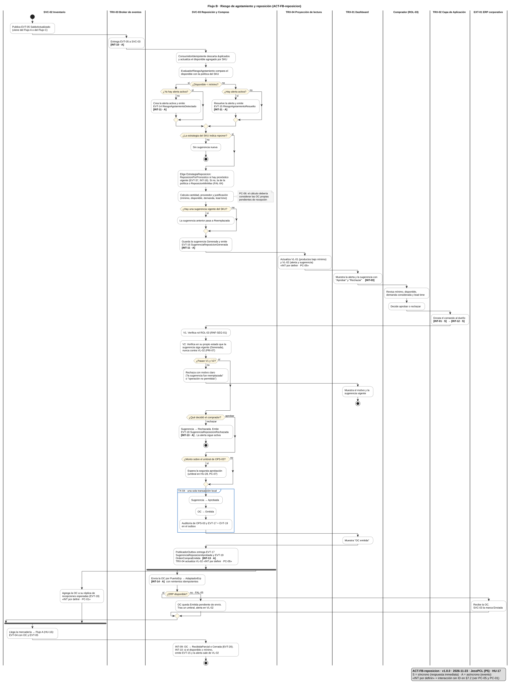
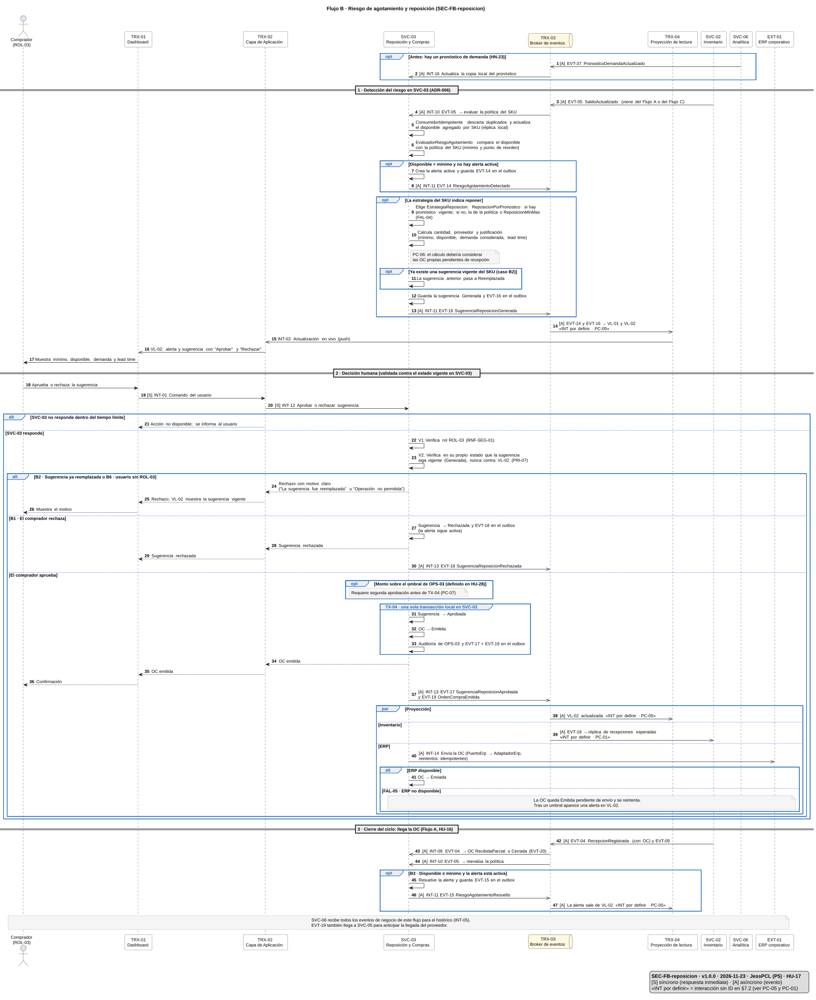

# Smart Inventory · Flujo B: riesgo de agotamiento y reposición

| Campo | Valor |
|---|---|
| Documento | `docs/arquitectura/flujos/flujo-b-reposicion.md` |
| Versión | **1.1.0** |
| Estado | Aprobado: PR #20 fusionado el 2026-11-24. El contrato v1.0.0 quedó aprobado en el acta del Sprint 1 (HU-10) |
| HU | HU-17 · Flujo B: riesgo de agotamiento y reposición, ADR-006 (Sprint 2 · 5 pts) |
| HN que diseña | HN-09, HN-10 y HN-11 (usa HN-08, HN-23 y HN-24 como reglas) |
| Dueño / Revisor | P5 / P4 |
| Diagramas | [`ACT-FB-reposicion`](../../../diagramas/actividad/src/ACT-FB-reposicion.puml) v1.0.0 · [`SEC-FB-reposicion`](../../../diagramas/secuencia/src/SEC-FB-reposicion.puml) v1.0.0 |
| ADR | [`ADR-006`](../../adr/ADR-006-deteccion-riesgo-en-reposicion.md) · La detección de riesgo de agotamiento pertenece a Reposición (Propuesto) |
| Contrato de referencia | [`docs/ARQUITECTURA_BASE.md`](../../ARQUITECTURA_BASE.md) v1.0.0 (§3.3, §5, §6, §7, §9, §10, §11) |
| Flujo anterior | `docs/arquitectura/flujos/flujo-a-recepcion.md` (PR #17): entrega EVT-05 → INT-10 |
| Criterio de la rúbrica | Flujos e interacciones arquitectónicas |
| Fecha | 2026-11-27 |

---

## 1. Propósito

Modela el Flujo B del enunciado: cuando un cambio de saldo deja a un SKU bajo su mínimo, **SVC-03 Reposición y Compras** detecta el riesgo, calcula una sugerencia y la presenta al comprador. La decisión de aprobar o rechazar es **humana** y SVC-03 la valida contra su estado vigente. Si se aprueba, la orden de compra se crea en una transacción local (**TX-04**) y se envía al ERP.

Es el tramo **alerta → reposición** del recorrido vertical (ARQUITECTURA_BASE §6.3, pasos 4 a 7 y 9). Recibe el EVT-05 del Flujo A (HU-16) o del Flujo C, y se cierra cuando la OC llega por el Flujo A.

La cadena oficial de eventos (CA1) es: **EVT-05 → EVT-14 → EVT-16 → EVT-17 → EVT-19**, con resolución por **EVT-15**.

---

## 2. Participantes y responsabilidades

| ID | Componente | Qué hace en este flujo | Qué **no** hace |
|---|---|---|---|
| ROL-03 | Comprador | Revisa la sugerencia y decide aprobar o rechazar | — |
| TRX-01 | Dashboard | Muestra la alerta y la sugerencia en VL-02 y envía la decisión | No decide ni valida el estado de la sugerencia |
| TRX-02 | Capa de Aplicación | Verifica la sesión y enruta la decisión a SVC-03 (INT-12) | No contiene reglas; la autorización final es de SVC-03 |
| SVC-03 | Reposición y Compras | Detecta el riesgo (`EvaluadorRiesgoAgotamiento`), calcula la sugerencia (`EstrategiaReposicion`), valida la decisión, ejecuta TX-04 y envía la OC (`PuertoErp` → `AdaptadorErp`) | No modifica saldos ni registra recepciones |
| TRX-03 | Broker de eventos | Distribuye los eventos al menos una vez y en orden por entidad | No decide |
| TRX-04 | Proyección de lectura | Consolida la alerta y la sugerencia en VL-01 y VL-02 | No detecta el riesgo ni decide (ADR-006) |
| SVC-02 | Inventario | Origen de EVT-05; guarda las OC emitidas en su réplica de recepciones esperadas | No decide reponer |
| SVC-06 | Analítica | Publica el pronóstico (EVT-37) y guarda el histórico (INT-05) | No es fuente de verdad |
| SVC-05 | Flota y Operación | Recibe EVT-19 para anticipar la llegada del proveedor | No participa en la decisión |
| EXT-01 | ERP corporativo | Recibe la OC a través del adaptador (INT-14) | — |

---

## 3. Precondiciones

- El SKU tiene una política de reposición configurada por ROL-03: mínimo, punto de reorden, cantidad objetivo y estrategia (HN-08; la modificación es OPS-04 y queda auditada).
- SVC-03 tiene sus réplicas al día (§3.3):
  - catálogo (INT-04)
  - disponible agregado por SKU (EVT-05, INT-10)
  - demanda no atendida (EVT-09)
  - pronóstico, si existe (EVT-37, INT-16)
- El proveedor del SKU tiene su lead time registrado en SVC-03.

---

## 4. Reglas de evaluación (ADR-006)

Cada vez que llega EVT-05, `EvaluadorRiesgoAgotamiento` aplica estas reglas sobre el disponible agregado del SKU:

| Situación | Qué hace SVC-03 | Evento |
|---|---|---|
| Disponible < mínimo y **no** hay alerta activa | Crea la alerta activa | EVT-14 RiesgoAgotamientoDetectado |
| Disponible < mínimo y ya hay alerta activa | Nada (no duplica la alerta) | — |
| Disponible ≥ mínimo y hay alerta activa | Resuelve la alerta | EVT-15 RiesgoAgotamientoResuelto |
| La estrategia del SKU indica reponer y **no** hay sugerencia vigente | Calcula y guarda la sugerencia | EVT-16 SugerenciaReposicionGenerada |
| La estrategia indica reponer y ya hay una sugerencia vigente | Solo genera una nueva si cambia la **cantidad** o el **proveedor** calculado; en ese caso la anterior pasa a *Reemplazada*. Si no cambia nada, mantiene la vigente (PC-08) | EVT-16 solo si hay una nueva |
| La estrategia no indica reponer | Nada | — |

**Ejemplo (HN-09):** con mínimo 100, si el disponible baja a 90 se emite EVT-14 y la alerta aparece en VL-02. Cuando el disponible vuelve a 100 o más, EVT-15 la retira.

### 4.1 Estrategias de reposición (§10)

| Estrategia | Cuándo se usa | Cuándo indica reponer (criterio de este diseño) |
|---|---|---|
| `ReposicionMinMax` | Por defecto, o cuando no hay pronóstico (FAL-04) | El disponible queda bajo el mínimo; pide hasta la cantidad objetivo |
| `ReposicionPuntoReorden` | Si la política del SKU la elige | El disponible queda bajo el punto de reorden |
| `ReposicionPorPronostico` | Si hay un pronóstico vigente (EVT-37, HN-23) | La demanda pronosticada durante el lead time supera el disponible |

Todas comparten la interfaz `EstrategiaReposicion`. Agregar una nueva no cambia el flujo (OCP, RNF-MAN-01). La sugerencia muestra mínimo, disponible, demanda considerada, lead time, cantidad y proveedor (HN-10).

---

## 5. Camino principal

La columna **SEC** indica el número de mensaje en [`SEC-FB-reposicion`](../../../diagramas/secuencia/export/SEC-FB-reposicion.svg).

| Paso | SEC | Qué ocurre | Responsable | Interacción | Modo | Evento / consistencia |
|---|---|---|---|---|---|---|
| 0 *(opcional)* | 1–2 | Analítica publica un pronóstico y SVC-03 actualiza su copia local | SVC-06 → TRX-03 → SVC-03 | INT-16 | A | EVT-37 |
| 1 | 3–4 | Un cambio de saldo llega a SVC-03 | SVC-02 → TRX-03 → SVC-03 | INT-10 | A | EVT-05 · CE-03 |
| 2 | 5–8 | SVC-03 descarta duplicados, evalúa la política y, si corresponde, crea la alerta | SVC-03 → TRX-03 | INT-11 | A | **EVT-14** |
| 3 | 9–13 | SVC-03 elige la estrategia y calcula la sugerencia; si ya hay una vigente, solo la reemplaza cuando cambia la cantidad o el proveedor (§4) | SVC-03 → TRX-03 | INT-11 | A | **EVT-16** |
| 4 | 14–17 | La proyección actualiza VL-01 y VL-02 y el comprador ve la sugerencia | TRX-03 → TRX-04 → TRX-02 → TRX-01 | «INT por definir», INT-03 | A | CE-01 |
| 5 | 18–20 | El comprador decide y TRX-02 enruta el comando a SVC-03 | ROL-03 → TRX-01 → TRX-02 → SVC-03 | INT-01, INT-12 | S | — |
| 6 | 22–23 | SVC-03 valida rol y estado vigente (§6) | SVC-03 | interna | — | — |
| 7 | 31–36 | **TX-04:** sugerencia *Aprobada* + OC *Emitida* + auditoría + outbox; el comprador ve "OC emitida" | SVC-03 | respuesta de INT-12 | S | **TX-04** |
| 8 | 37–39 | Se publican la aprobación y la OC; VL-02 se actualiza y SVC-02 registra la recepción esperada | SVC-03 → TRX-03 → TRX-04, SVC-02, SVC-05 | INT-13 | A | **EVT-17**, **EVT-19** |
| 9 | 40–41 | La OC se envía al ERP y pasa a *Enviada* | SVC-03 → EXT-01 | INT-14 | A (con reintentos) | — |
| 10 | 42–47 | Llega la mercadería (Flujo A): la OC avanza o se cierra y, si el disponible ≥ mínimo, la alerta se resuelve | TRX-03 → SVC-03 | INT-09, INT-10, INT-11 | A | EVT-20, **EVT-15** |

---

## 6. Decisión humana y validación contra el estado vigente (CA2)

La decisión **siempre es humana** en el MVP (§3.3). SVC-03 la valida con **sus propios datos**, nunca con lo que muestra VL-02, porque la vista puede estar atrasada (PRI-07).

| ID | Validación | Si falla |
|---|---|---|
| V1 | El usuario tiene ROL-03 (RNF-SEG-01) | Rechazo "operación no permitida"; queda registrado (HN-24) |
| V2 | La sugerencia sigue vigente: estado *Generada* según `EstadoSugerencia` | Rechazo "la sugerencia fue reemplazada" y VL-02 muestra la vigente (HN-11) |
| V3 | Si el monto supera el umbral de OPS-03 (lo define HU-28), se requiere una segunda aprobación antes de TX-04 | La OC no se emite hasta tener la segunda aprobación (PC-07) |

**Si el comprador aprueba → TX-04** (una sola transacción local en SVC-03):
1. La sugerencia pasa a *Aprobada*.
2. La OC se crea en estado *Emitida*.
3. Se registra la auditoría de OPS-03.
4. EVT-17 y EVT-19 se guardan en el outbox.

**Si el comprador rechaza:** la sugerencia pasa a *Rechazada* y se emite EVT-18 (INT-13). **La alerta sigue activa**, porque el riesgo no desapareció.

**Transiciones inválidas** (las controla `EstadoSugerencia`, patrón State): aprobar o rechazar una sugerencia que ya está *Aprobada*, *Rechazada* o *Reemplazada*.

---

## 7. Caminos alternativos (CA3)

| ID | Situación | SEC | Qué pasa | Qué ve el usuario | Contrato |
|---|---|---|---|---|---|
| **B1** | El comprador rechaza la sugerencia | 27–30 | Sugerencia *Rechazada* y EVT-18; la alerta sigue activa | "Sugerencia rechazada"; la alerta sigue en VL-02 | HN-11, EVT-18 |
| **B2** | **Sugerencia reemplazada:** llegó otro EVT-05, se generó una sugerencia nueva y el comprador aprobó la anterior desde una vista atrasada | 11, 24–26 | V2 falla y no se emite nada | "La sugerencia fue reemplazada"; VL-02 muestra la vigente | HN-10, HN-11, PRI-07 |
| **B3** | **Resolución del riesgo:** llega la mercadería y el disponible vuelve a ≥ mínimo | 42–47 | SVC-03 resuelve la alerta y emite EVT-15 | La alerta desaparece de VL-02 | HN-09, EVT-15 |
| **B4** | El ERP no está disponible | 40, nota | La OC queda *Emitida* pendiente de envío, con reintentos idempotentes | Tras un umbral, alerta en VL-02 | FAL-05, RIE-07 |
| **B5** | Analítica no disponible o sin pronóstico | 9 | Se usa el último pronóstico o `ReposicionMinMax` | Sin cambios | FAL-04 |
| **B6** | Usuario sin ROL-03 (por ejemplo, ROL-06) | 24–26 | V1 falla y queda registrado | "Operación no permitida" | HN-24, RNF-SEG-01 |
| **B7** | Broker no disponible | — | No llegan EVT-05 a SVC-03 y no hay detección; al volver, se procesan en orden | Vistas *Con retraso* o *Desactualizada* | FAL-01, RNF-DIS-01, RIE-03 |
| **B8** | SVC-03 no responde a INT-12 | 21 | No se aprueba ni rechaza nada | "Acción no disponible" | INT-12 (§7.2) |

---

## 8. Estados que intervienen (§9)

| Entidad | Transiciones usadas en este flujo | Diagrama de estados |
|---|---|---|
| Sugerencia de reposición | *Generada* (EVT-16) → *Aprobada* (EVT-17), *Rechazada* (EVT-18) o *Reemplazada* (nueva EVT-16 del mismo SKU) | EST-sugerencia (HU-25, P4) |
| Orden de compra | *Emitida* (EVT-19) → *Enviada* (INT-14) → *RecibidaParcial* → *Cerrada* (EVT-20) | EST-orden-compra (HU-25, P4) |
| Alerta de riesgo de agotamiento | activa (EVT-14) → resuelta (EVT-15) | Dato de SVC-03 (§3.3) |

---

## 9. Consistencia, calidad y patrones

- **Transacción local:** TX-04 en SVC-03. El resto es consistencia eventual: CE-03 (detección, ≤ 5 s desde EVT-05), CE-01 (vistas, ≤ 5 s) y CE-06 (avance de OC, ≤ 60 s).
- **Latencia de la alerta:** HN-09 pide la alerta en VL-02 en ≤ 5 s, pero CE-03 y CE-01 pueden sumar unos 10 s. Está registrado como H-01 en HU-08 y se resuelve en HU-27.
- **Requisitos relacionados:** RNF-SEG-01 (rol y auditoría de OPS-03), RNF-MAN-01 (estrategias), RNF-CON-02 (frescura de VL-02) y RNF-DIS-01 (broker caído).
- **Patrones (§10):**

| Patrón | Dónde | Qué resuelve |
|---|---|---|
| Strategy | `EstrategiaReposicion` → `ReposicionMinMax`, `ReposicionPuntoReorden`, `ReposicionPorPronostico` | Cambiar cómo se calcula la sugerencia sin tocar el flujo (OCP) |
| State | `EstadoSugerencia`, `EstadoOrdenCompra` | Impedir transiciones inválidas, como aprobar una sugerencia *Reemplazada* |
| Adapter | `PuertoErp` → `AdaptadorErp` | Aislar el ERP; cambiarlo no toca el dominio (DIP) |
| Outbox e idempotencia | `PublicadorOutbox`, `ConsumidorIdempotente` | El cambio y su evento se guardan juntos; los duplicados no repiten efectos |
| CQRS | TRX-04 (VL-01, VL-02) | La vista muestra la alerta sin convertirse en fuente de verdad |

- **SRP:** `EvaluadorRiesgoAgotamiento` (SVC-03) está separado de `RegistroMovimientos` (SVC-02). Esto se justifica en ADR-006.
- **Riesgos relacionados (HU-08):** RIE-03, RIE-05, RIE-07 y RIE-08.

---

## 10. Diagramas

### 10.1 Actividad · ACT-FB-reposicion v1.0.0

### 10.2 Secuencia · SEC-FB-reposicion v1.0.0

Fuentes PlantUML: `diagramas/actividad/src/ACT-FB-reposicion.puml` y `diagramas/secuencia/src/SEC-FB-reposicion.puml`.

---

## 11. Puntos abiertos («PROPUESTA DE CAMBIO», no oficiales)

La numeración continúa la de HU-16 (PC-01 a PC-04). Ninguno se usa como oficial hasta aprobarse por ARQUITECTURA_BASE §0.3.

| ID | Hallazgo | Propuesta | Dueño |
|---|---|---|---|
| PC-05 | **Interacciones del Flujo B que no tienen ID en §7.2:** (a) TRX-03 → TRX-04 con EVT-14 a EVT-19 para VL-01 y VL-02 (el Flujo A sí la tiene: INT-08); (b) TRX-03 → SVC-03 con EVT-09, la demanda no atendida; (c) la consulta síncrona del detalle de la sugerencia, que §5 menciona; (d) TRX-02 → SVC-03 para configurar la política (HN-08, OPS-04). En los diagramas aparecen como «INT por definir» | Agregarlas a §7.2 (MINOR) | P1, P6 (HU-24) |
| PC-06 | **Riesgo de compra duplicada:** mientras la OC aprobada no llega, el disponible sigue bajo el mínimo y cada EVT-05 podría generar otra sugerencia | Que `EstrategiaReposicion` considere las OC propias en *Emitida*, *Enviada* o *RecibidaParcial*. Es un dato de SVC-03, así que no rompe PRI-02 | P5, P1 |
| PC-07 | **Segunda aprobación de OPS-03:** §9 no define un estado intermedio para la sugerencia mientras espera la segunda aprobación, ni quién la da | Definirlo junto con el umbral en HU-28 y reflejarlo en EST-sugerencia (HU-25) | P2 (HU-28), P4 (HU-25) |
| PC-08 | **Cuándo se regenera una sugerencia:** "una nueva reemplaza a la anterior" (§3.3) no dice cuándo se genera una nueva. Si se regenera con cada EVT-05, VL-02 cambia todo el tiempo y aumentan los rechazos por reemplazo (B2) | Regenerar solo si cambia la cantidad o el proveedor calculado | P5 · **Resuelto en v1.1.0** (§4) |

---

## 12. Trazabilidad

| HN | Capacidades | Interacciones | Eventos · transacción | Diagramas | ADR | RNF |
|---|---|---|---|---|---|---|
| HN-09 | SVC-03, TRX-04 | INT-10, INT-11, INT-03 | EVT-05, EVT-14, EVT-15 | ACT-FB-reposicion v1.0.0, SEC-FB-reposicion v1.0.0 | ADR-006, ADR-005 | RNF-CON-02 (y H-01 para HU-27) |
| HN-10 | SVC-03 | INT-10, INT-11, INT-16 | EVT-16, EVT-37 | ACT-FB-reposicion v1.0.0, SEC-FB-reposicion v1.0.0 | ADR-006 | RNF-MAN-01 |
| HN-11 | SVC-03, EXT-01 | INT-01, INT-12, INT-13, INT-14 | EVT-17, EVT-18, EVT-19 · TX-04 | ACT-FB-reposicion v1.0.0, SEC-FB-reposicion v1.0.0 | ADR-004 | RNF-SEG-01 |
| HN-24 (regla) | SVC-03 | INT-12 | — | SEC-FB-reposicion v1.0.0 (B6) | — | RNF-SEG-01 |

---

## Historial de cambios de este documento

| Versión | Fecha | Autor | Cambio | HU |
|---|---|---|---|---|
| 1.0.0 | 2026-11-23 | P5 | Versión inicial: reglas de evaluación, camino principal, decisión humana, caminos B1 a B8, estados, patrones, trazabilidad y PC-05 a PC-08 | HU-17 |
| 1.1.0 | 2026-11-27 | P5 | Resuelve PC-08: una sugerencia nueva solo se genera si cambia la cantidad o el proveedor calculado (§4). Se mueve a `docs/arquitectura/flujos/` y los diagramas a `diagramas/actividad/` y `diagramas/secuencia/` (BACKLOG §8.1 y CONTRIBUTING); se actualizan el estado y los enlaces | HU-17 |
