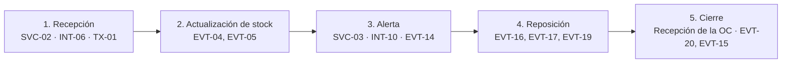

# Smart Inventory · Visión del producto, interesados y MVP

| Campo | Valor |
|---|---|
| Documento | `equipo/P2-EstebanEsp07/HU-02-vision.md` (borrador de `docs/producto/vision-y-mvp.md`) |
| Versión | **1.0.0** |
| Estado | Propuesto para revisión (PR de HU-02) |
| Autor | P2 · Product Owner (`EstebanEsp07`) |
| Revisor | P3 · Scrum Master y gestor de versiones (revisión cruzada, `docs/BACKLOG.md` §1.2) |
| Fecha | 2026-11-23 |
| HU | **HU-02** Visión del producto y MVP · Sprint 1 · rúbrica: Gestión del proyecto y sprints |
| Épicas vinculadas | EP-01 a EP-08. El MVP cubre EP-01 a EP-06 y EP-08; EP-07 solo aporta la ingesta al Lakehouse (INT-05) |
| Contrato de referencia | `docs/ARQUITECTURA_BASE.md` v1.0.0 y `docs/BACKLOG.md` v1.0.0 |

> Todos los identificadores (`SVC`, `TRX`, `EXT`, `UD`, `EVT`, `INT`, `VL`, `RNF`, `ROL`, `OPS`, `SUP`, `CE`, `ADR`) son los del contrato. No se crearon identificadores nuevos.

---

## 1. Visión del producto

### 1.1 Problema

Un centro de distribución necesita saber en todo momento **qué hay, dónde está, de qué lote es y cuándo vence**, pero hoy esa información, la reposición, el despacho y la operación de flota y patio se gestionan por separado. Las consecuencias, según el escenario del enunciado, son:

- Quiebres de stock porque la reposición reacciona tarde.
- Lotes que vencen sin haberse despachado primero (sin criterio FEFO).
- Pedidos que se pierden o se sobrevenden cuando falla un componente.
- Coordinación manual entre bodega, AMR, camiones y muelles.
- Supervisores sin una vista en vivo confiable, que además no indica qué tan reciente es el dato.

### 1.2 Usuarios

Siete perfiles de usuario (ROL-01 a ROL-07, `ARQUITECTURA_BASE` §11.4): Operador de bodega, Supervisor de bodega, Comprador, Operador de patio y flota, Supervisor de operaciones, Analista y Administrador. Detalle en §2.

### 1.3 Declaración de visión

> **Para** los equipos de bodega, compras y operaciones de un centro de distribución
> **que necesitan** saber qué existe, dónde y cuándo vence, reponer antes del quiebre y despachar sin perder pedidos,
> **Smart Inventory** es una plataforma empresarial integrada de inventario, fulfillment y operación logística
> **que** mantiene una fuente única de verdad por dato, reserva con FEFO, sugiere reposiciones trazables, coordina AMR, camiones y muelles, y permite supervisar todo en un dashboard que informa la antigüedad de sus datos.
> **A diferencia de** sistemas aislados o procesos manuales, **nuestro producto** define límites claros por capacidad (SVC-01 a SVC-06) y puede evolucionar de un monolito modular a microservicios sin rediseñar sus interacciones (ADR-001, PRI-09).

### 1.4 Propuesta de valor

| Valor | Cómo lo entrega | Módulo |
|---|---|---|
| Saldo confiable por SKU · ubicación · lote | Fuente única de existencias con movimientos inmutables y disponible nunca negativo | SVC-02 |
| Reponer antes del quiebre | Detección de riesgo en cada cambio de saldo, sugerencia con justificación y aprobación humana | SVC-03 |
| Despachar primero lo que vence antes | Reserva síncrona con FEFO; lotes *Vencido* o *EnCuarentena* nunca se asignan | SVC-02, SVC-04 |
| Operación coordinada | Asignación de AMR, muelles y camiones por capacidad dueña | SVC-05 |
| Supervisión en vivo y honesta | Dashboard con modos Planta interna y Planta externa e indicador de frescura | TRX-01, TRX-04 |
| Seguridad por rol | Autorización en la capacidad dueña y auditoría de operaciones sensibles | EP-08, EXT-04 |

### 1.5 Métricas de éxito

Las metas formales vienen del contrato (`ARQUITECTURA_BASE` §7.3 y §11.2). Los umbrales se validan o ajustan en HU-27.

| Métrica de éxito | Meta | Fuente |
|---|---|---|
| Recepciones reflejadas en el dashboard | ≥ 95 % en menos de 5 s con carga normal | RNF-REN-03 |
| Resolución de una reserva FEFO | ≤ 1 s p95 en carga normal; ≤ 2 s p95 en pico | RNF-REN-02 |
| Integridad del disponible | 0 reservas que superen el disponible | RNF-CON-01 |
| Pedidos perdidos si Inventario no responde | 0 (quedan en *PendienteReserva* y se reintentan) | RNF-DIS-02 |
| Detección de riesgo de agotamiento | ≤ 5 s desde EVT-05 | CE-03 |
| Recuperación del disponible tras cancelar un pedido | ≤ 60 s | CE-05 |
| Disponibilidad del núcleo transaccional | ≥ 99,5 % del horario operativo mensual | RNF-DIS-04 |
| Transparencia de los datos | Toda vista muestra su antigüedad; aviso si supera 60 s | RNF-CON-02 |

**Indicadores de negocio direccionales** (sin ID oficial; se cuantifican en HU-27 y se observan con VL-07 después del MVP): menos quiebres de stock, menos lotes vencidos sin despachar y menos pedidos en espera por falta de stock.

---

## 2. Interesados

> **Nota de alcance.** En `docs/BACKLOG.md` §4.1 el entregable `docs/producto/interesados.md` (HU-03) es de P6 y lo revisa P2. Esta sección es la propuesta del Product Owner solicitada para la visión y sirve de insumo para P6; si hay diferencias, prevalece lo que acuerden P2 y P6 en esa HU.

### 2.1 Registro de interesados

Influencia: A = alta, M = media, B = baja. Interés: igual escala.

| # | Interesado | Tipo | Rol / sistema | Interés | Influencia | Necesidad principal | Épicas |
|---|---|---|---|---|---|---|---|
| 1 | Operador de bodega | Usuario | ROL-01 | A | M | Registrar recepciones y consultar existencias reales por lote y vencimiento; confirmar preparaciones | EP-02, EP-03, EP-04 |
| 2 | Supervisor de bodega | Usuario | ROL-02 | A | M | Corregir diferencias con auditoría y priorizar la salida de lotes por vencer | EP-02 |
| 3 | Comprador | Usuario | ROL-03 | A | A | Detectar riesgo de agotamiento a tiempo y decidir la reposición con datos | EP-03, EP-07 |
| 4 | Operador de patio y flota | Usuario | ROL-04 | A | M | Asignar tareas a AMR, y ordenar llegadas de camiones y muelles | EP-05 |
| 5 | Supervisor de operaciones | Usuario | ROL-05 | A | A | Reservar con FEFO, no perder pedidos y supervisar la planta en vivo | EP-04, EP-06 |
| 6 | Analista | Usuario | ROL-06 | M | B | Consultar históricos y pronósticos para mejorar políticas | EP-07 |
| 7 | Administrador | Usuario | ROL-07 | A | M | Mantener catálogo, ubicaciones, usuarios y roles | EP-01, EP-08 |
| 8 | Dirección de operaciones y logística *(patrocinador; supuesto del PO, sin ROL)* | Patrocinador | — | M | A | Menos quiebres y vencimientos, y una operación visible de punta a punta | EP-06, EP-07 |
| 9 | ERP corporativo | Sistema externo | EXT-01 | B | M | Recibir órdenes de compra y entregar pedidos de venta de forma confiable | EP-03, EP-04 |
| 10 | Transportistas y control de acceso del patio | Sistema externo | EXT-02, EXT-05 | B | B | Confirmar vehículos y horarios; informar llegadas y salidas | EP-05 |
| 11 | Fabricante del controlador de flota AMR | Sistema externo | EXT-03 | B | M | Recibir misiones y emitir telemetría sin acoplar el dominio | EP-05 |
| 12 | Proveedor de identidad (IdP) | Sistema externo | EXT-04 | B | M | Autenticar usuarios y entregar sus roles | EP-08 |
| 13 | Proveedores de mercadería *(sin ROL)* | Externo | — | M | B | Recibir órdenes de compra y entregar según lead time | EP-03 |
| 14 | Equipo de Desarrollo de Software Moderno | Implementador | — | A | M | Una especificación de diseño consistente para implementar APIs, mensajes y pruebas | EP-01 a EP-08 |
| 15 | Docente evaluador (USFQ) | Evaluador del proyecto | — | A | A | Artefactos completos, coherentes y trazables según la rúbrica | EP-01 a EP-08 |

Los interesados 8, 13, 14 y 15 no tienen ROL de seguridad: son supuestos del PO derivados del escenario y del enunciado, a confirmar con P6 en HU-03.

### 2.2 Matriz poder / interés

| | **Interés alto** | **Interés medio o bajo** |
|---|---|---|
| **Influencia alta** | **Gestionar de cerca:** Supervisor de operaciones (5), Comprador (3), Docente evaluador (15) | **Mantener satisfecho:** Dirección de operaciones y logística (8) |
| **Influencia media o baja** | **Mantener informado:** Operador de bodega (1), Supervisor de bodega (2), Operador de patio y flota (4), Administrador (7), Equipo de Desarrollo de Software Moderno (14) | **Monitorear:** Analista (6), ERP (9), transportistas y acceso (10), fabricante AMR (11), IdP (12), proveedores (13) |

### 2.3 Perfiles de usuario y roles

Cada perfil corresponde a un rol del contrato. Se indican las HN de cada uno: **M** entra al MVP, el resto queda fuera.

| Rol | Perfil | HN de prioridad Must | Otras HN |
|---|---|---|---|
| ROL-01 | Operador de bodega | HN-03, HN-04, HN-12, HN-15 | HN-05 (S) |
| ROL-02 | Supervisor de bodega | HN-07 | HN-06 (S) |
| ROL-03 | Comprador | HN-08, HN-09, HN-10, HN-11 | HN-23 (C) |
| ROL-04 | Operador de patio y flota | HN-17, HN-18 | — |
| ROL-05 | Supervisor de operaciones | HN-13, HN-14, HN-19, HN-20, HN-21 | HN-16 (S) |
| ROL-06 | Analista | — | HN-22 (C) |
| ROL-07 | Administrador | HN-01, HN-02, HN-24 | — |

---

## 3. MVP

### 3.1 Definición

El MVP es **el conjunto de las 19 historias de negocio con prioridad Must** (`docs/BACKLOG.md` §2.2). Recorre los flujos A, B y C por su camino principal y permite demostrar el flujo vertical **recepción → actualización de stock → alerta → reposición**, cerrado con la recepción de la OC (§3.5).

### 3.2 Qué entra: las 19 historias Must

Ordenadas por su posición en el product backlog.

| Orden | HN | Épica | Módulo | Rol | Qué permite | Flujo | Diseñada en |
|---|---|---|---|---|---|---|---|
| 1 | HN-01 | EP-01 | SVC-01 | ROL-07 | Registrar productos con SKU, categoría, unidad y reglas de lote y vencimiento | T | HU-07, HU-13 |
| 2 | HN-02 | EP-01 | SVC-01 | ROL-07 | Definir bodegas, zonas y ubicaciones con capacidad y estado | T | HU-07, HU-13 |
| 3 | HN-24 | EP-08 | EXT-04, todos los SVC | ROL-07 | Asignar roles; cada capacidad dueña rechaza lo no permitido | T | HU-28 |
| 4 | HN-03 | EP-02 | SVC-02 | ROL-01 | Registrar recepción con lote, cantidad, ubicación y vencimiento | A | HU-14, HU-16 |
| 5 | HN-04 | EP-02 | SVC-02 | ROL-01 | Consultar existencias por SKU, ubicación y lote | A | HU-14, HU-24 |
| 6 | HN-08 | EP-03 | SVC-03 | ROL-03 | Configurar mínimo y punto de reorden por SKU | B | HU-15, HU-17 |
| 7 | HN-09 | EP-03 | SVC-03 | ROL-03 | Recibir alerta cuando un SKU cae bajo su mínimo | B | HU-17, HU-22 |
| 8 | HN-10 | EP-03 | SVC-03 | ROL-03 | Ver sugerencia de reposición con cantidad, proveedor y justificación | B | HU-15, HU-17 |
| 9 | HN-11 | EP-03 | SVC-03 | ROL-03 | Aprobar o rechazar la sugerencia y generar la OC | B | HU-17, HU-25 |
| 10 | HN-12 | EP-03 | SVC-02, SVC-03 | ROL-01 | Registrar la recepción contra una OC y cerrar el ciclo de compra | A, B | HU-16, HU-25 |
| 11 | HN-20 | EP-06 | TRX-01, TRX-02, TRX-04 | ROL-05 | Ver KPIs y alertas en vivo con la antigüedad del dato | T | HU-22, HU-32 |
| 12 | HN-21 | EP-06 | TRX-01, TRX-02, TRX-04 | ROL-05 | Alternar entre Planta interna y Planta externa | T | HU-22, HU-32 |
| 13 | HN-13 | EP-04 | SVC-04, SVC-02 | ROL-05 | Reservar stock con FEFO al registrar un pedido | C | HU-14, HU-18 |
| 14 | HN-14 | EP-04 | SVC-04 | ROL-05 | Dejar en espera los pedidos sin stock suficiente | C, B | HU-18, HU-26 |
| 15 | HN-15 | EP-04 | SVC-04 | ROL-01 | Generar y confirmar la tarea de preparación | C | HU-18, HU-26 |
| 16 | HN-17 | EP-05 | SVC-05 | ROL-04 | Asignar tareas de preparación a un AMR disponible con su ruta | C | HU-19, HU-26 |
| 17 | HN-18 | EP-05 | SVC-05 | ROL-04 | Registrar llegada de camiones y asignar muelle | A, C | HU-19, HU-26 |
| 18 | HN-19 | EP-05 | SVC-05, SVC-04, SVC-02 | ROL-05 | Cerrar el pedido y descontar el stock al salir el camión | C | HU-18, HU-24 |
| 19 | HN-07 | EP-02 | SVC-02 | ROL-02 | Ver lotes próximos a vencer (VL-02 y KPI de VL-01) | A | HU-14, HU-25 |

Cobertura por épica: EP-01 (2), EP-02 (3), EP-03 (5), EP-04 (3), EP-05 (3), EP-06 (2), EP-08 (1). Total 19.

### 3.3 Qué no entra

| Queda fuera | Prior. | Razón |
|---|---|---|
| HN-05 Transferir existencias entre ubicaciones | S | No es necesaria para el flujo vertical |
| HN-06 Ajustes con motivo y auditoría | S | La corrección de diferencias puede esperar; OPS-01 se diseña igual en HU-28 |
| HN-16 Cancelar un pedido antes del despacho | S | El camino principal no lo requiere; la coreografía de compensación se diseña igual en el flujo C (HU-18) |
| HN-22 Indicadores históricos (VL-07) | C | La analítica del MVP se limita a la ingesta al Lakehouse (INT-05) |
| HN-23 Sugerencias con pronóstico | C | Sin pronóstico se usa `ReposicionMinMax` (FAL-04) |

Decisiones de alcance adicionales del MVP, tomadas del contrato:

- La reserva es **todo o nada**; no se reservan pedidos parcialmente (SVC-04).
- La aprobación de sugerencias es **humana** (SVC-03).
- No hay predicción de demanda: no se usan EVT-37 ni INT-16.
- El dashboard es solo lectura y nunca es fuente de verdad (PRI-07).
- Nada de lo diseñado incluye APIs, mensajes técnicos, CI/CD, pruebas ni despliegue (`ARQUITECTURA_BASE` §14).

### 3.4 Agrupación del MVP

Según `ARQUITECTURA_BASE` §2.3, ADR-001 y ADR-007:

| UD | Contenido |
|---|---|
| UD-1 Núcleo transaccional | SVC-01, SVC-02, SVC-03, SVC-04 (monolito modular) |
| UD-2 Flota y Operación | SVC-05 |
| UD-3 Analítica | SVC-06 + TRX-05 (en el MVP, solo ingesta) |
| UD-4 Acceso | TRX-01, TRX-02 |
| UD-5 Proyección de lectura | TRX-04 |
| Infraestructura | TRX-03 (broker), EXT-04 (IdP) |

### 3.5 Flujo vertical del MVP

Pasos de `ARQUITECTURA_BASE` §6.3 y las HN que los cubren:

| Paso | Qué ocurre | Dueño | INT / EVT | HN |
|---|---|---|---|---|
| 1 | El operador registra la recepción (lote, vencimiento, ubicación) | ROL-01 → SVC-02 | INT-01, INT-06 | HN-03 |
| 2 | Inventario guarda lote, movimiento, saldo y outbox (TX-01) | SVC-02 | INT-07 · EVT-04, EVT-05 | HN-03, HN-04, HN-20 |
| 3 | Reservas y salidas bajan el disponible | SVC-04 → SVC-02 | INT-19, INT-30 · EVT-08, EVT-11, EVT-05 | HN-13, HN-19 |
| 4 | Reposición evalúa la política: disponible < mínimo | SVC-03 | INT-10 · EVT-14 | HN-08, HN-09 |
| 5 | Reposición calcula la sugerencia | SVC-03 | INT-11 · EVT-16 | HN-10 |
| 6 | El comprador aprueba; se crea la OC (TX-04) | ROL-03 → SVC-03 | INT-12 · EVT-17, EVT-19 | HN-11 |
| 7 | La OC se envía al ERP | SVC-03 → EXT-01 | INT-14 (A) | HN-11 |
| 8 | Llega el camión del proveedor y se recibe la OC | SVC-05, SVC-02 | INT-28, INT-06 · EVT-33, EVT-04, EVT-05 | HN-18, HN-12 |
| 9 | Reposición cierra la OC y resuelve el riesgo | SVC-03 | INT-09, INT-10 · EVT-20, EVT-15 | HN-12, HN-09 |

El dashboard acompaña todo el recorrido (HN-20, HN-21; VL-01, VL-02, VL-04, VL-05 y VL-06).

---

## 4. Supuestos y restricciones

### 4.1 Supuestos de carga (contrato, a validar en HU-27)

| ID | Supuesto |
|---|---|
| SUP-01 | Un centro de distribución, 4 muelles, 20 AMR, ~5.000 SKU activos y ~30.000 combinaciones SKU · ubicación · lote |
| SUP-02 | Carga normal: 60 usuarios concurrentes, 1.500 movimientos/hora, 300 pedidos/hora, telemetría de 20 AMR a 1 muestra por segundo |
| SUP-03 | Carga pico: 3× la carga normal |

### 4.2 Supuestos del producto (propuestos por P2, sin ID oficial)

- Las capturas del enunciado (Figuras 3 y 4) usan datos ilustrativos y no representan conexión con servicios reales.
- La identidad y los roles de los usuarios los entrega EXT-04; el producto no administra contraseñas.
- La dirección de operaciones actúa como patrocinador aunque no sea un ROL del sistema.

### 4.3 Restricciones

- **Alcance de diseño:** se entrega una especificación revisable; no se construye el software. Quedan fuera APIs, mensajes técnicos, rate limiting, pruebas, CI/CD, DevOps y despliegue (`ARQUITECTURA_BASE` §14).
- **Calendario:** 4 sprints de 2 semanas y 7 integrantes (`docs/BACKLOG.md` §3).
- **Nomenclatura:** solo IDs del contrato; los cambios siguen `ARQUITECTURA_BASE` §0.3.
- **Datos:** un único dueño por dato (PRI-01) y sin escritura cruzada (PRI-02).
- **Dashboard:** vista de consulta con consistencia eventual informada (§8.2 del contrato).
- **Seguridad:** sin secretos ni datos personales reales en el repositorio (RNF-SEG-02).

---

## 5. Trazabilidad y criterios de aceptación de HU-02

| CA (`docs/BACKLOG.md` §4.1) | Dónde se cumple |
|---|---|
| CA1. Visión en una página: problema, usuarios, propuesta de valor y métricas de éxito | §1.1, §1.2, §1.4, §1.5 |
| CA2. MVP delimitado, coherente con `ARQUITECTURA_BASE` §2.3 y con las HN de prioridad M | §3.2, §3.3, §3.4 |
| CA3. Flujo vertical explícito (`ARQUITECTURA_BASE` §6.3) | §3.5 |
| CA4. Supuestos y restricciones, incluidos SUP-01 a SUP-03 | §4 |

Rúbrica: *Gestión del proyecto y sprints*. Épicas: EP-01 a EP-08 (`docs/BACKLOG.md` §2.1). Historias: HN de prioridad M (`HU-04-historias.md`). Épicas validadas: `HU-03-epicas.md`.

---

## Historial de cambios de este documento

| Versión | Fecha | Autor | Cambio | HU |
|---|---|---|---|---|
| 1.0.0 | 2026-11-23 | P2 | Versión inicial: visión, interesados y MVP con las 19 HN Must | HU-02 |
