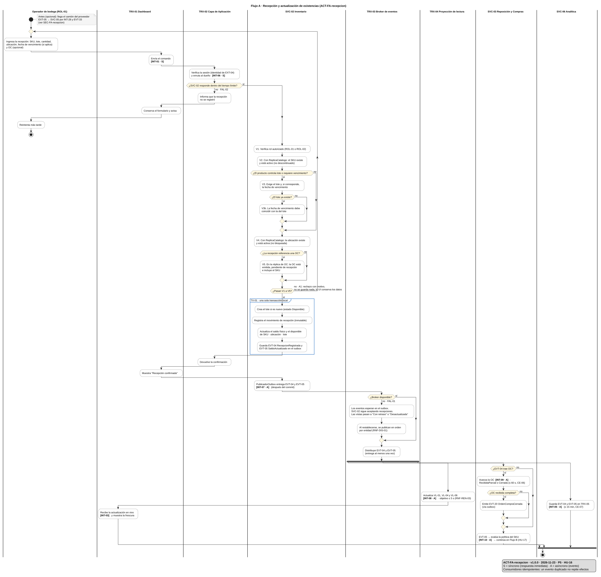
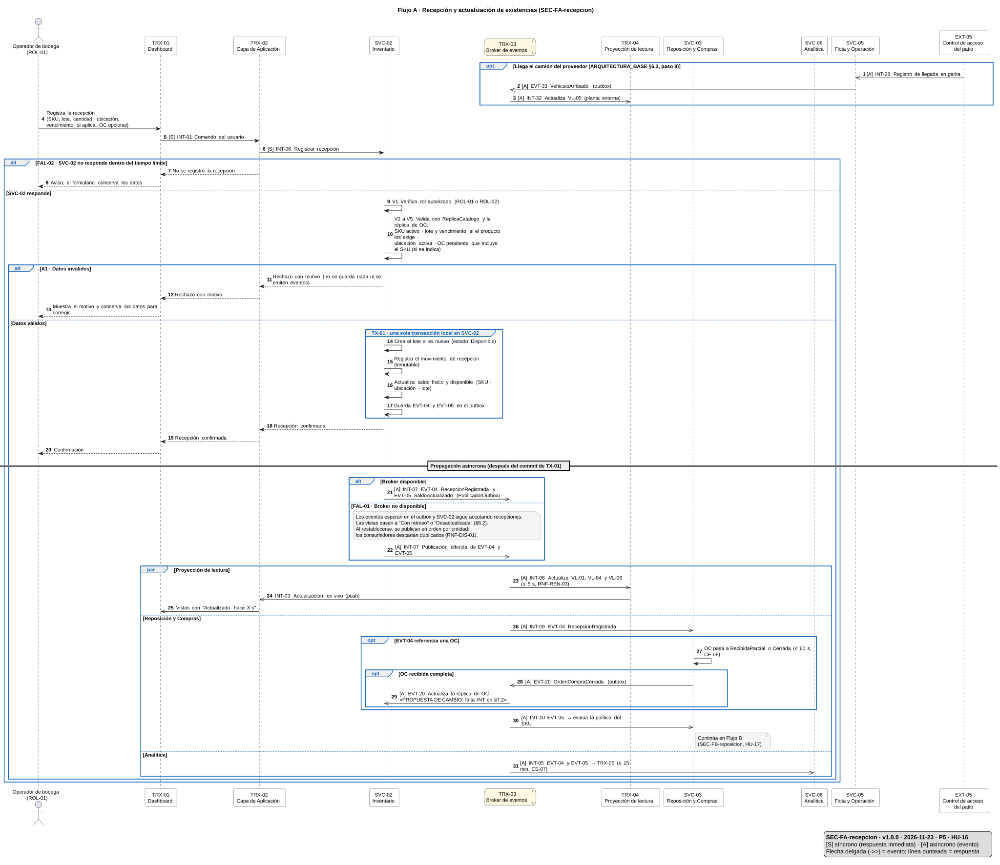

# Smart Inventory · Flujo A: recepción y actualización de existencias

| Campo | Valor |
|---|---|
| Documento | `equipo/P5-JessPCL/HU-16-flujo-a-recepcion.md` |
| Versión | **1.0.0** |
| Estado | Borrador listo para revisión. El PR se abre cuando se cierre el issue #7 (aprobación del contrato) |
| HU | HU-16 · Flujo A: recepción y actualización de existencias (Sprint 2 · 3 pts) |
| HN que diseña | HN-03 y HN-12 (usa las reglas de HN-01 y HN-02 en las validaciones) |
| Dueño / Revisor | P5 / P4 |
| Diagramas | [`ACT-FA-recepcion`](../../docs/diagramas/fuente/ACT-FA-recepcion.puml) v1.0.0 · [`SEC-FA-recepcion`](../../docs/diagramas/fuente/SEC-FA-recepcion.puml) v1.0.0 |
| Contrato de referencia | [`docs/ARQUITECTURA_BASE.md`](../../docs/ARQUITECTURA_BASE.md) v1.0.0 (§3.2, §5, §6, §7, §11) |
| Criterio de la rúbrica | Flujos e interacciones arquitectónicas |
| Fecha | 2026-11-23 |

---

## 1. Propósito

Modela el Flujo A del enunciado: un operador registra la llegada de mercadería y el saldo queda actualizado en **SVC-02 Inventario**, que es el único dueño de saldo, lote, movimiento y recepción (ARQUITECTURA_BASE §5). El cambio se guarda en una transacción local (**TX-01**) y se comunica a los demás componentes por eventos con Outbox (**EVT-04 RecepcionRegistrada** y **EVT-05 SaldoActualizado**).

Este flujo es el primer tramo del recorrido vertical **recepción → actualización de stock → alerta → reposición** (ARQUITECTURA_BASE §6.3, pasos 1, 2 y 8). La alerta y la reposición continúan en el Flujo B (HU-17).

---

## 2. Participantes y responsabilidades (CA4)

| ID | Componente | Qué hace en este flujo | Qué **no** hace |
|---|---|---|---|
| ROL-01 | Operador de bodega (también ROL-02) | Ingresa la recepción: SKU, lote, cantidad, ubicación, fecha de vencimiento si aplica y OC opcional | — |
| TRX-01 | Dashboard | Captura los datos, envía el comando y muestra la confirmación y la frescura de las vistas | No valida reglas de negocio ni guarda datos |
| TRX-02 | Capa de Aplicación | Verifica la sesión (identidad de EXT-04, INT-02) y enruta el comando a SVC-02 | No contiene reglas de negocio; la autorización final es de SVC-02 |
| SVC-02 | Inventario | Valida (V1 a V5), ejecuta TX-01 y publica EVT-04 y EVT-05 por Outbox | No decide reponer (SVC-03) ni cambia el estado de la OC (SVC-03) |
| TRX-03 | Broker de eventos | Distribuye los eventos al menos una vez y en orden por entidad | No transforma datos ni decide |
| TRX-04 | Proyección de lectura | Actualiza VL-01, VL-04 y VL-06 y las envía en vivo a TRX-02 (INT-03) | No es fuente de verdad ni genera alertas |
| SVC-03 | Reposición y Compras | Avanza o cierra la OC (INT-09, EVT-20) y evalúa la política del SKU con EVT-05 (INT-10 → Flujo B) | No modifica saldos |
| SVC-06 | Analítica | Guarda los eventos en TRX-05 para el histórico (INT-05) | No tiene impacto operativo |
| SVC-05 · EXT-05 | Flota y Operación · Control de acceso del patio | *(Opcional)* Registran la llegada del camión del proveedor (INT-28, EVT-33, INT-32 → VL-05) | No participan en el registro de la recepción |

---

## 3. Precondiciones

- El usuario inició sesión (INT-02) y tiene ROL-01 o ROL-02 (§11.4).
- El producto y la ubicación ya están en la réplica de catálogo de SVC-02 (INT-04, CE-02).
- Si la recepción referencia una OC, la OC fue emitida y ya está en la réplica de OC de SVC-02 (EVT-19).

---

## 4. Camino principal

La columna **SEC** indica el número de mensaje en [`SEC-FA-recepcion`](../../docs/diagramas/export/SEC-FA-recepcion.svg).

| Paso | SEC | Qué ocurre | Responsable | Interacción | Modo | Evento / consistencia |
|---|---|---|---|---|---|---|
| 0 *(opcional)* | 1–3 | Llega el camión del proveedor y aparece en la planta externa | EXT-05 → SVC-05 → TRX-03 → TRX-04 | INT-28, INT-32 | A | EVT-33 → VL-05 |
| 1 | 4–6 | El operador registra la recepción; TRX-01 envía el comando y TRX-02 lo enruta a SVC-02 | ROL-01, TRX-01, TRX-02 | INT-01, INT-06 | S | — |
| 2 | 9–10 | SVC-02 aplica las validaciones V1 a V5 (§5) | SVC-02 | interna | — | — |
| 3 | 14–17 | **TX-01:** lote (si es nuevo) + movimiento + saldo + outbox, todo o nada | SVC-02 | interna | — | **TX-01** |
| 4 | 18–20 | El operador recibe "Recepción confirmada" | SVC-02 → TRX-02 → TRX-01 | respuesta de INT-06 e INT-01 | S | — |
| 5 | 21 | `PublicadorOutbox` publica los eventos guardados en TX-01 | SVC-02 → TRX-03 | INT-07 | A | EVT-04, EVT-05 |
| 6 | 23–25 | La proyección actualiza las vistas y las envía en vivo al dashboard | TRX-03 → TRX-04 → TRX-02 → TRX-01 | INT-08, INT-03 | A | VL-01, VL-04, VL-06 · CE-01 |
| 7 | 26–29 | Si EVT-04 trae OC, la OC pasa a *RecibidaParcial* o *Cerrada*; si se cierra, se emite EVT-20 | TRX-03 → SVC-03 | INT-09 | A | EVT-20 · CE-06 |
| 8 | 30 | SVC-03 evalúa EVT-05 contra la política del SKU → **Flujo B** | TRX-03 → SVC-03 | INT-10 | A | CE-03 |
| 9 | 31 | Analítica guarda los eventos para el histórico | TRX-03 → SVC-06 | INT-05 | A | CE-07 |

Ejemplo de HN-12: una OC de 200 u. queda *Cerrada* (EVT-20) si se reciben 200, y *RecibidaParcial* si se reciben 120.

---

## 5. Validaciones de la recepción (CA1)

Todas las ejecuta **SVC-02**, el dueño, con sus propias réplicas de solo lectura (PRI-04). Nunca consulta en línea a SVC-01 ni a SVC-03.

| ID | Validación | Dato que usa | Origen del dato | Si falla |
|---|---|---|---|---|
| V1 | El usuario tiene ROL-01 o ROL-02 | Roles del usuario | EXT-04 (INT-02) | Rechazo: operación no permitida |
| V2 | El SKU existe y está activo (no descontinuado) | `ReplicaCatalogo` | SVC-01 por EVT-01 y EVT-02 | Rechazo: SKU inexistente o descontinuado |
| V3 | Si el producto controla lote, el lote es obligatorio; si requiere vencimiento, la fecha es obligatoria (HN-01, HN-03) | Atributos del producto en `ReplicaCatalogo` | SVC-01 por EVT-01 y EVT-02 | Rechazo: falta lote o fecha de vencimiento |
| V3b | Si el lote ya existe, la fecha de vencimiento coincide con la del lote (un lote tiene una sola fecha, §13) | Lote | SVC-02 (propio) | Rechazo: la fecha no coincide con el lote |
| V4 | La ubicación existe y está activa (no bloqueada) (HN-02) | `ReplicaCatalogo` | SVC-01 por EVT-03 | Rechazo: ubicación bloqueada o inexistente |
| V5 | *(Solo si se indica una OC)* La OC está emitida, pendiente de recepción e incluye el SKU (HN-12) | Réplica de OC | SVC-03 por EVT-19 y EVT-20 | Rechazo: OC no encontrada o ya cerrada |

En el diagrama de actividad, V3 y V5 aparecen como decisiones ("cuando corresponda" y "opcional") y el rechazo vuelve al operador mediante un ciclo.

---

## 6. Caminos alternativos (CA3)

| ID | Situación | SEC | Qué pasa | Qué ve el usuario | Contrato |
|---|---|---|---|---|---|
| **A1** | Datos inválidos (falla alguna de V1 a V5) | 11–13 | SVC-02 rechaza **antes** de TX-01: no guarda nada ni emite eventos | El motivo del rechazo; el formulario conserva los datos para corregir y reenviar | HN-01, HN-02, HN-03 |
| **A2** | **Broker no disponible** | 22 | TX-01 se confirma igual. EVT-04 y EVT-05 esperan en el outbox y SVC-02 sigue aceptando recepciones. Mientras tanto, SVC-03 no recibe EVT-05 (no hay evaluación de riesgo). Al volver el broker, los eventos se publican en orden por entidad y los consumidores descartan duplicados | "Recepción confirmada"; las vistas pasan a *Con retraso* y, pasados 60 s, a *Desactualizada* (§8.2) | FAL-01, RNF-DIS-01, RNF-CON-02 |
| **A3** | SVC-02 no responde dentro del tiempo límite | 7–8 | No se registra nada | Aviso; el formulario conserva los datos para reintentar | FAL-02 |
| **A4** | Réplica atrasada: el SKU o la OC se crearon hace segundos | 11–13 | V2 o V5 fallan porque la réplica aún no los tiene. Es una variante de A1 | Rechazo con aviso de reintentar en unos segundos | CE-02 |

---

## 7. Consistencia y calidad

- **Transacción local:** solo TX-01, dentro de SVC-02. Todo lo demás es consistencia eventual: CE-01 (vistas, ≤ 5 s), CE-02 (réplicas, ≤ 5 s), CE-06 (avance de OC, ≤ 60 s) y CE-07 (Lakehouse, ≤ 15 min).
- **RNF-REN-03:** el 95 % de las recepciones se refleja en VL-01 en menos de 5 s con carga normal. Se mide desde el commit de TX-01 hasta la actualización de VL-01 (INT-07 + INT-08).
- **RNF-DIS-01:** con el broker caído no se pierden ni se duplican efectos (camino A2).
- **RNF-CON-02:** toda vista muestra la antigüedad de su dato.
- **Patrones y puertos (§10):** `RegistroMovimientos` (puerto de entrada de la recepción), `ReplicaCatalogo` (réplicas, PRI-04, ADR-009), `PublicadorEventos` → `PublicadorOutbox` (Outbox, PRI-06, ADR-004), `ConsumidorIdempotente` en TRX-04, SVC-03 y SVC-06, y `ActualizadorVista` en TRX-04 (CQRS, ADR-005).
- **Riesgos relacionados (HU-08):** RIE-03 (eventos perdidos o duplicados) y RIE-06 (réplicas atrasadas).

---

## 8. Diagramas

### 8.1 Actividad · ACT-FA-recepcion v1.0.0

### 8.2 Secuencia · SEC-FA-recepcion v1.0.0

Fuentes PlantUML: `docs/diagramas/fuente/ACT-FA-recepcion.puml` y `docs/diagramas/fuente/SEC-FA-recepcion.puml`.

---

## 9. Puntos abiertos («PROPUESTA DE CAMBIO», no oficiales)

Ninguno se usa como oficial hasta aprobarse por ARQUITECTURA_BASE §0.3.

| ID | Hallazgo | Propuesta | Dueño |
|---|---|---|---|
| PC-01 | La réplica de OC de SVC-02 (y la de SVC-05) se alimenta con EVT-19 y EVT-20, pero **ninguna INT de §7.2 cubre esa entrega**: INT-04 solo cubre catálogo e INT-13 solo la publicación. En SEC-FA-recepcion (mensaje 29) la flecha queda marcada | Agregar una INT "SVC-03 → TRX-03 → SVC-02, SVC-05: EVT-19 y EVT-20 → mantener la réplica de OC" (MINOR) | P1, P6 (HU-24) |
| PC-02 | **Idempotencia del registro de recepción:** si TRX-02 agota el tiempo límite después de que SVC-02 confirmó TX-01, el operador podría reenviar y duplicar la recepción. El contrato solo define clave de idempotencia para la reserva (INT-19) | La recepción lleva un identificador generado al capturarla y SVC-02 ignora un reenvío con el mismo identificador | P4 (SVC-02), P1 |
| PC-03 | No está definido qué pasa si se recibe un lote cuya **fecha de vencimiento ya pasó**: rechazarlo, o registrarlo directamente como *Vencido* | Decidirlo junto con los estados de lote (HU-25) | P4 |
| PC-04 | No está definido qué pasa si se recibe **más de lo pendiente en la OC** | Decidir si V5 lo rechaza o si SVC-03 lo resuelve al avanzar la OC (INT-09) | P5 (HU-17), P4 |

---

## 10. Trazabilidad

| HN | Capacidades | Interacciones | Eventos · transacción | Diagramas | ADR | RNF |
|---|---|---|---|---|---|---|
| HN-03 | SVC-02 | INT-01, INT-06, INT-07, INT-08, INT-03 | EVT-04, EVT-05 · TX-01 | ACT-FA-recepcion v1.0.0, SEC-FA-recepcion v1.0.0 | ADR-004, ADR-005, ADR-009 | RNF-REN-03, RNF-DIS-01, RNF-CON-02 |
| HN-12 | SVC-02, SVC-03 | INT-06, INT-09 | EVT-04, EVT-20 | ACT-FA-recepcion v1.0.0, SEC-FA-recepcion v1.0.0 | ADR-004, ADR-009 | RNF-DIS-01 |
| HN-01, HN-02 (reglas) | SVC-01 → réplica en SVC-02 | INT-04 | EVT-01, EVT-02, EVT-03 | ACT-FA-recepcion v1.0.0 (V2 a V4) | ADR-009 | — |

---

## Historial de cambios de este documento

| Versión | Fecha | Autor | Cambio | HU |
|---|---|---|---|---|
| 1.0.0 | 2026-11-23 | P5 | Versión inicial: camino principal, validaciones V1 a V5, caminos A1 a A4, trazabilidad y PC-01 a PC-04 | HU-16 |
