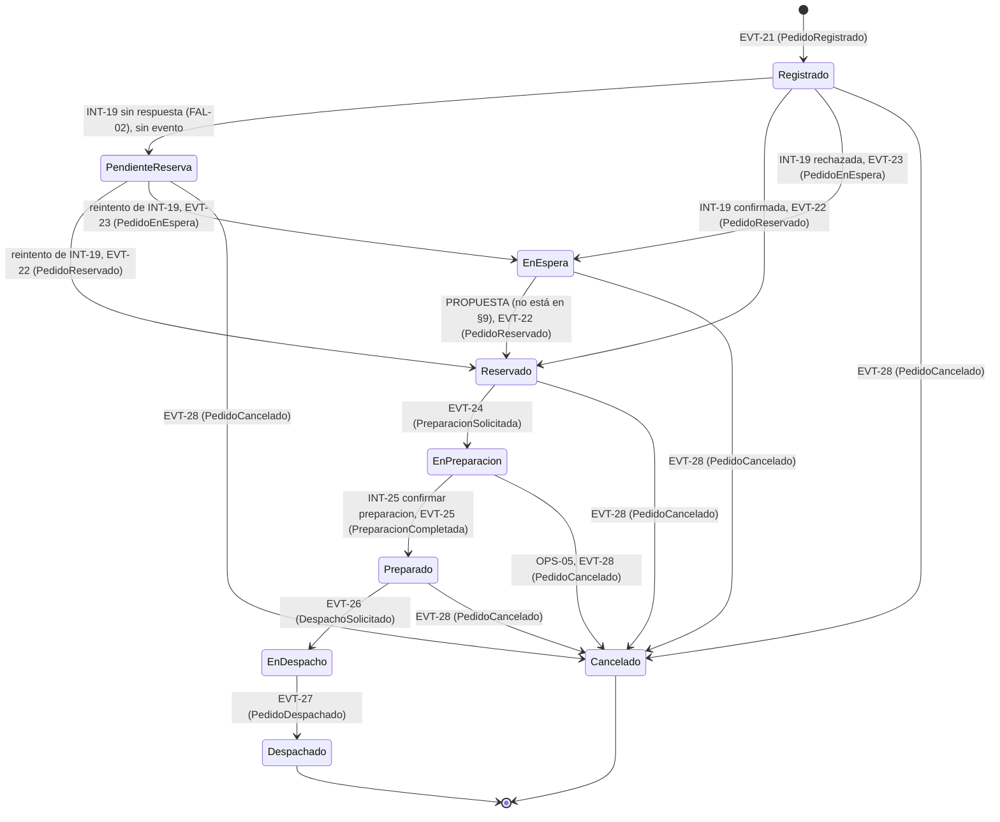

# Anexo HU-07 · Validación de dominio y datos: SVC-04 y SVC-05

- **Historia:** HU-07 · Glosario y modelo conceptual de dominio
- **Aporte de:** P6 (Pedidos y Flota)
- **Revisor:** P5
- **Responsable de HU-07:** P4
- **Contrato de referencia:** `docs/ARQUITECTURA_BASE.md` v1.0.0 (§3.4, §3.5, §5, §6.2, §7.2, §9)
- **Estado:** Borrador de apoyo. No modifica el contrato.

## 1. Propiedad de datos y no escritura cruzada (PRI-01, PRI-02, PRI-03)

### SVC-04 · Pedidos y Fulfillment
- **Datos propietarios (fuente única de verdad):** `Pedido` y su estado (§9), `Tarea de preparación`, `Solicitud de despacho`.
- **Relación con SVC-02 (Inventario):**
  - `SVC-04` **no escribe** en los datos de `SVC-02` (`Saldo`, `Lote` y `fecha de vencimiento`, `Movimiento`, `Reserva`).
  - `SVC-04` solicita la reserva de forma síncrona mediante `INT-19` (modo `S`) y conserva solo el identificador de la reserva y una **copia de solo lectura** de la asignación por lote recibida en la respuesta para preparar el pedido. El dueño de la reserva sigue siendo `SVC-02`.
  - Las referencias entre `SVC-04` y `SVC-02` son por identificador (`PRI-03`), sin escritura directa entre esquemas (`PRI-02`).
- **Evidencia de que SVC-02 es quien escribe y SVC-04 solo avisa:**
  - Salida de stock: `EVT-27` (`PedidoDespachado`) → `INT-30` → `SVC-02` registra `EVT-11` y `EVT-05` (`TX-03`).
  - Liberación de reserva: `EVT-28` (`PedidoCancelado`) → `INT-31` → `SVC-02` emite `EVT-10`.
- **Eventos:** `SVC-04` publica solo `EVT-21` a `EVT-28` y no consume eventos de saldo, lote ni reserva. El resultado de la reserva llega por la respuesta de `INT-19`.
- **Réplicas locales en SVC-04:** Catálogo (`EVT-01`, `EVT-02`) y muelle asignado (`EVT-34`).
- **Observación O-1:** la copia de asignación puede quedar desfasada si `SVC-02` libera la reserva (`EVT-10`). El desfase es del lado conservador (`CE-05`); la copia se usa solo para preparar el pedido, nunca para decidir.

### SVC-05 · Flota y Operación
- **Datos propietarios (fuente única de verdad):** `AMR`, `Misión AMR`, `Ruta`, `Telemetría` (posición y batería), `Visita de vehículo`, `Muelle`, `Patio` (acceso, zona de espera).
- **Exclusividad de telemetría y patio:** `SVC-05` es el único dueño de la telemetría y del patio/muelles. La telemetría cruda no sale de `SVC-05`; hacia `TRX-04` se publica únicamente la señal muestreada `EVT-32` (`PosicionFlotaActualizada`), y los hechos de operación se comunican mediante eventos de negocio (`EVT-29` a `EVT-31`, `EVT-33` a `EVT-36`).
- **Entradas externas:** solo mediante adaptadores (`EXT-03` con `INT-22` e `INT-23`; `EXT-02` con `INT-27`; `EXT-05` con `INT-28`). Las acciones manuales las ejecuta el dueño (`INT-33`).
- **Sin escritura sobre Pedidos:** `SVC-05` solo consume `EVT-24`, `EVT-26` y `EVT-28`; el estado del pedido sigue en `SVC-04`.
- **Réplicas locales en SVC-05:** Ubicaciones y layout (`EVT-03`) y órdenes de compra emitidas (`EVT-19`).

### Hallazgo H-1 (contradicción interna del contrato)
`§3.6` indica que `SVC-06` consume `EVT-32` "solo por muestreo", pero `§5`, `§6.1` y `§6.2` limitan la señal a `TRX-04` (solo visualización, no llega al Lakehouse). La propiedad de `SVC-05` no cambia, pero se contradice quién puede consumir la señal.

- Mientras no se resuelva, este anexo sigue `§5`, `§6.1` y `§6.2`.
- Estado: **PROPUESTA**. La corrección requiere un PR aparte sobre `ARQUITECTURA_BASE.md` con ADR "Propuesto" (`§0.3`), aprobado por P1 y el diseñador del módulo afectado.

## 2. Entidades de SVC-04 y SVC-05 para el modelo conceptual (HU-07 CA2 y CA3)

Sin atributos técnicos. Toda relación con otro módulo es solo por identificador (`PRI-03`).

| Módulo | Entidad | Referencia a otros módulos (solo ID) |
|---|---|---|
| SVC-04 | Pedido | SKU de cada línea (SVC-01); identificador de reserva (SVC-02) |
| SVC-04 | Tarea de preparación | Identificador del pedido (propio) |
| SVC-04 | Solicitud de despacho | Identificador del pedido (propio); muelle asignado, réplica por `EVT-34` (SVC-05) |
| SVC-04 | Copia de asignación por lote (solo lectura) | Reserva, lote y ubicación, tal como los devolvió `INT-19` (SVC-02) |
| SVC-05 | AMR | — |
| SVC-05 | Misión AMR | Tarea de preparación (SVC-04, vía `EVT-24`) |
| SVC-05 | Ruta | Ubicación (SVC-01, réplica por `EVT-03`) |
| SVC-05 | Telemetría | AMR (propio) |
| SVC-05 | Visita de vehículo | OC esperada (SVC-03, `EVT-19`); pedido a despachar (SVC-04, `EVT-26`) |
| SVC-05 | Muelle | Visita de vehículo (propio) |
| SVC-05 | Patio | — |

*La referencia de Visita de vehículo al pedido se infiere de `EVT-26`; queda por confirmar con P4.*

## 3. Adelanto del diagrama de estados de Pedido (ARQUITECTURA_BASE §9)

Dueño del estado: `SVC-04` (controlado por `EstadoPedido`). Estados finales: `Despachado`, `Cancelado`.

> Nota: `EVT-28` (`PedidoCancelado`) solo procede desde estados previos a `EnDespacho` (§3.4 y §9). Al cancelarse, `SVC-02` libera la reserva (`EVT-10`) y `SVC-05` cancela misiones asociadas (`INT-31`).
>
> **Pendiente (Q-1):** §9 no define cómo sale un pedido de `EnEspera`. La transición `EnEspera → Reservado` es una **PROPUESTA** y no es oficial hasta resolverse vía §0.3. Las salidas de `PendienteReserva` son lectura de §3.4 ("se reintenta").

### Transiciones inválidas
- Cualquier salida de `Despachado` o `Cancelado` (estados finales).
- `EnDespacho → Cancelado` (solo se cancela antes del despacho).
- `EnEspera → EnPreparacion` sin pasar por `Reservado` (la reserva es todo o nada).
- `Registrado → EnPreparacion` (se salta la reserva).
- `Preparado → EnPreparacion` (no hay retroceso).
